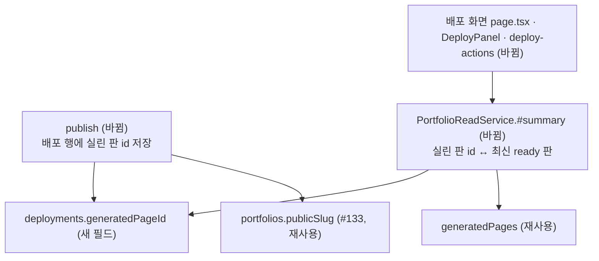

# 같은 주소 재배포와 편집 후 배포 변경 표시 — 명세

## 요구사항

- [ ] 포트폴리오 요약(`PortfolioReadService.#summary`)의 `deployment.hasUnpublishedChanges`는 현재 배포에 실린 지면 판과 최신 ready 지면 판이 다르면 true입니다.
- [ ] 실린 판 id가 없는 옛 배포는 최신 ready 판이 배포 시각 뒤에 만들어졌으면 true입니다.
- [ ] 같은 판을 다시 배포하면 false로 돌아옵니다. 옛 배포로 되돌리면 true입니다.
- [ ] 배포 화면은 구조화 지면을 「지면 판 N」으로 부릅니다. 주소 입력 `pattern`이 `v` 플래그 정규식으로 유효합니다.

같은 주소 재배포, 다른 포트폴리오 주소 409, 옮겨지는 옛 주소 보호, 방문 기록의 주소 조회는 PR #133이 `portfolios.publicSlug`(마이그레이션 0023)로 이미 합니다. 되돌리기는 #133대로 주소를 그대로 두고 내용만 되돌립니다.

## 설계

- **변경 여부는 읽을 때 계산합니다.** `publish`가 실린 판 id를 배포 행의 `generatedPageId`에 남깁니다. `#summary`는 현재 배포의 `generatedPageId`와 최신 ready 판 `_id`를 비교합니다. `generatedPageId`가 없는 옛 배포는 최신 ready 판의 `createdAt > publishedAt`로 봅니다. 저장된 `hasUnpublishedChanges` 필드는 계약 호환을 위해 그대로 쓰되 계산값과 OR 합니다.
- `deployments`의 validator는 추가 필드를 막지 않으므로 마이그레이션이 필요 없습니다.

## 버린 대안

- **변경 표시를 쓰기 쪽에서 켜기:** 판을 만드는 경로가 여럿입니다(생성 · 다듬기 채택 · 직접 편집 · 판 되돌리기, PR #138의 요소 지시 · 기록 추가). 하나라도 빠지면 다시 틀립니다. 되돌리기 배포 뒤에는 끌 시점도 없습니다.
- **스냅샷을 읽어 실린 판 번호 비교:** 스냅샷은 수 MB 조각으로 저장됩니다. 포트폴리오 목록마다 읽기에는 무겁습니다.
- **주소 소유를 따로 구현(`publishedSlug`, 0025):** #133이 같은 모델을 먼저 넣어 지웠습니다.

## 함정

- #133 머지 전에 이 브랜치의 0025를 적용한 DB는 `deployment_subdomain_idx`를 다른 키로 가집니다. 그 DB는 0025 기록 · `publishedSlug` · 두 인덱스를 지운 뒤 0023을 적용합니다.

## 완료 기준

- `pnpm typecheck`, `pnpm test`, `pnpm test:infra`, `test:load`가 통과합니다.
- 복사본 DB(`expresso_refine`)를 정리하고 0023을 적용한 뒤, 실제 화면에서 v1 배포 → 편집 → 「다릅니다」 → v2 배포 → 「같습니다」 → v1 되돌리기 → 「다릅니다」를 확인합니다.
