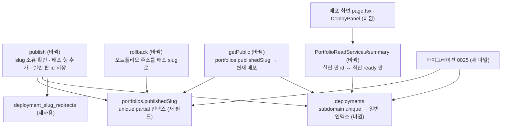

# 같은 주소 재배포와 편집 후 배포 변경 표시 — 명세

## 요구사항

- [ ] 같은 포트폴리오가 같은 slug로 `publish`를 두 번 부르면 v1 · v2 두 배포가 생깁니다. 공개 주소(`getPublic`)는 v2를 돌려줍니다.
- [ ] 다른 포트폴리오가 이미 쓰는 slug로 `publish`하면 409입니다. 동시에 같은 slug로 배포하면 하나만 성공합니다(기존 경합 테스트 유지).
- [ ] 다른 포트폴리오의 옛 주소 이동(redirect)이 살아 있는 slug도 409입니다.
- [ ] `rollback`은 그 배포의 slug를 포트폴리오 주소로 되돌립니다. 그 slug를 다른 포트폴리오가 쓰고 있으면 409입니다.
- [ ] 포트폴리오 요약(`PortfolioReadService.#summary`)의 `deployment.hasUnpublishedChanges`는 현재 배포에 실린 지면 판과 최신 ready 지면 판이 다르면 true입니다.
- [ ] 이 변경 전에 만든 배포(실린 판 id가 없음)는 최신 ready 판이 배포 시각 뒤에 만들어졌으면 true입니다.
- [ ] 마이그레이션 0025은 기존 포트폴리오의 주소를 현재 배포에서 채우고, 인덱스를 바꿉니다. 다시 돌려도 결과가 같습니다.
- [ ] 배포 화면은 구조화 지면을 「지면 판 N」으로 부릅니다. 주소 입력 `pattern`이 `v` 플래그 정규식으로 유효합니다.

## 설계

- **주소 소유를 포트폴리오로 옮깁니다.** 지금은 `deployments.subdomain`의 전역 unique 인덱스가 주소를 지킵니다. 그런데 배포는 버전마다 행을 더하므로 두 번째 행부터 충돌합니다. 주소는 포트폴리오의 속성입니다. 그래서 `portfolios.publishedSlug`에 unique partial 인덱스(`$type: "string"`)를 두고, `deployments.subdomain`은 일반 인덱스로 바꿉니다.
  - `publish`는 트랜잭션 안에서 다른 포트폴리오의 살아 있는 옛 주소 이동을 확인합니다. 이어서 배포 행을 넣고, 포트폴리오에 `publishedSlug` · `currentDeploymentId`를 씁니다. 다른 포트폴리오가 같은 slug를 동시에 쓰면 unique 인덱스가 하나를 실패시킵니다(11000 → 409). 트랜잭션이므로 실패한 쪽의 배포 행도 남지 않습니다.
  - `getPublic`은 `portfolios.findOne({ publishedSlug: slug, status: "published" })`로 포트폴리오를 찾습니다. 현재 배포의 `subdomain`이 slug와 같을 때 돌려줍니다. 옛 주소 이동 처리는 그대로입니다.
  - `rollback`은 `publishedSlug`를 그 배포의 `subdomain`으로 씁니다.
- **변경 여부는 읽을 때 계산합니다.** `publish`가 실린 판 id를 배포 행의 `generatedPageId`에 남깁니다. `#summary`는 현재 배포의 `generatedPageId`와 최신 ready 판 `_id`를 비교합니다. `generatedPageId`가 없는 옛 배포는 최신 ready 판의 `createdAt > publishedAt`로 봅니다. 이렇게 하면 지면을 만드는 모든 경로(생성 · 다듬기 · 편집 · 되돌리기)를 고치지 않아도 됩니다. 되돌리기로 옛 배포가 현재가 되어도 정확합니다. 저장된 `hasUnpublishedChanges` 필드는 계약 호환을 위해 그대로 쓰되 계산값과 OR 합니다.
- **마이그레이션 0025** `publishing_slug_ownership`:
  1. 현재 배포가 있는 포트폴리오에 `publishedSlug = 그 배포의 subdomain`을 채웁니다. 지금은 subdomain이 전역 unique라 중복이 없습니다.
  2. `portfolio_published_slug_key`(unique, partial)를 만듭니다.
  3. `deployment_subdomain_key`를 지우고 `deployment_subdomain_idx`(일반)를 만듭니다.
  - 각 단계는 있으면 건너뜁니다. validator는 `additionalProperties`를 막지 않아 고치지 않습니다.

## 버린 대안

- **재배포 때 기존 배포 행을 덮어쓰기:** 버전마다 스냅샷을 얼려 두는 지금 설계(v1으로 되돌리기)를 깨뜨립니다.
- **변경 표시를 쓰기 쪽에서 켜기:** 판을 만드는 경로가 여럿입니다(생성 · 다듬기 채택 · 직접 편집 · 되돌리기, PR #138의 요소 지시 · 기록 추가). 하나라도 빠지면 다시 틀립니다. 그리고 되돌리기 배포 뒤에는 끌 시점이 없습니다.
- **스냅샷을 읽어 실린 판 번호 비교:** 스냅샷은 수 MB 조각으로 저장됩니다. 포트폴리오 목록마다 읽기에는 무겁습니다.

## 함정

- 0001 스키마의 `deployment_subdomain_key`는 이미 배포된 DB에 있습니다. 새 DB는 0001이 만든 뒤 0025가 바꿉니다. 두 경로 모두 같은 결과여야 합니다.
- 공개 중단(`unlisted`) 포트폴리오도 `publishedSlug`를 가집니다. 주소는 계속 그 포트폴리오 몫입니다(지금과 같음).
- `deploymentSlugRedirects.oldSlug`는 전역 unique입니다. 주소를 바꾸면 옛 주소가 이동 표에 남습니다. 다른 포트폴리오가 그 옛 주소로 배포하려 하면 이동 기간 동안 막습니다.
- 메인 체크아웃의 0022는 이미 `ai_usage_and_plan_credits`가 씁니다. 0023은 PR #133, 0024는 PR #136이 씁니다. 그래서 0025를 씁니다.

## 완료 기준

- `pnpm typecheck`, `pnpm test`, `pnpm test:infra`가 통과합니다.
- 복사본 DB(`expresso_refine`)에 0025를 적용합니다. 그 뒤 실제 화면에서 v1 배포 → 편집 → 「다릅니다」 표시 → 같은 주소로 v2 배포 → 공개 주소 반영 → v1 되돌리기를 확인합니다.
