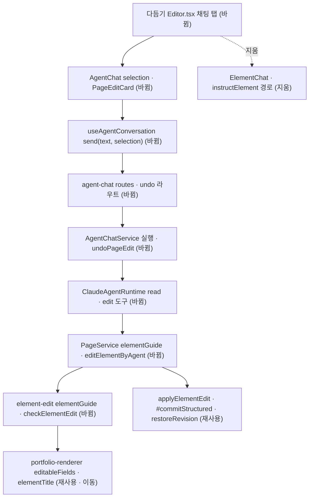

# 다듬기 채팅을 공통 에이전트 채팅으로 교체 — 명세

## 요구사항

- [ ] 구조화 지면(`generationManifest.structured`)의 채팅 탭은 고른 요소와 관계없이 `AgentChat`을 `context={kind:"portfolio"}`로 그린다. 처음 열 대화는 이 포트폴리오가 연결된 가장 최근 대화다(`restore: "context"`).
- [ ] 보내기 요청(`SendAgentMessage`)과 저장된 사용자 메시지(`AgentMessage`)에 선택 요소 `selection {portfolioId, key, label}`이 선택적으로 실린다. 모델에 넘기는 대화(`conversationForModel`)에도 실린다.
- [ ] 에이전트 도구 `read_page_element`는 연결된 포트폴리오의 요소 하나에 대해 종류 · 설명 · 지금 모양 · 고를 수 있는 값 · 글자 부분 · 글 경로와 현재 글 · 출처를 돌려준다.
- [ ] 에이전트 도구 `edit_page_element`는 AI를 다시 부르지 않고 입력을 검사해 새 판을 저장한다. 연결되지 않은 포트폴리오 · 없는 요소 · 허용하지 않는 값 · 출처에 없는 숫자 · 바뀐 곳 없음은 `AgentToolRejection`으로 그 항목과 허용 값을 돌려준다(같은 대화에서 고쳐 다시 부른다).
- [ ] 성공한 고침은 도구 결과 `pageEdit {editId, portfolioId, key, label, note, changes, revision, undone}`로 남는다.
- [ ] `POST /agent/conversations/:id/page-edits/:editId/undo`는 최신 판이 `pageEdit.revision`일 때만 `revision - 1`의 내용을 새 판으로 쌓고 `undone: true`로 바꾼다. 그 뒤에 다른 판이 있으면 409, 실행 중이면 409, 이미 되돌렸으면 그대로 돌려준다.
- [ ] 포트폴리오 문맥은 구조화 지면이면 HTML 대신 목차(`outline: {key, title, type}[]`)를 싣는다. 자유 HTML 지면은 지금처럼 HTML을 싣는다.
- [ ] 화면: 고른 요소가 있으면 입력창 위와 보낸 말풍선에 대상 표시가 보인다. `pageEdit` 카드는 바뀐 곳 목록과 「되돌리기」(최신 판이 아니면 비활성)를 그린다. 고침 · 되돌리기가 끝나면 미리보기를 다시 불러온다.
- [ ] `ElementChat` · `instructElementAction` · `page.instructElement`(웹 endpoint · 백엔드 라우트 · `PageService.instructElement` · `PageElementEditor.instruct`) · `InstructStructuredElementSchema`를 지운다.

## 설계

**재사용** — 공통 채팅 전체(`AgentChatService` 실행 · 저장 · SSE, `useAgentConversation`, `AgentChat`, `ToolStep`), 페이지 모듈의 `applyElementEdit` · `elementChanges` · `restoreRevision` · `#commitStructured`, 숫자 근거 검사 `ungroundedNumbers` · `metricValueAllowed`, 렌더러의 `editableFields` · `STRUCTURED_PARTS` · `elementTextPaths` · `textPathLabel`.

**페이지 모듈** — `element-edit.ts`의 `instruct` 안에 있던 프롬프트 재료와 `check`를 순수 함수 둘로 꺼낸다. `elementGuide(snapshot, key, design)`은 도구가 읽을 설명을, `checkElementEdit(snapshot, key, edit, design)`은 위반 문장 목록이나, 통과하면 적용한 스냅샷과 바뀐 곳을 낸다. `PageService`에 `elementGuide(userId, portfolioId, key)`와 `editElementByAgent(userId, portfolioId, key, edit, note)`를 더한다. 후자는 최신 판을 기준으로 `checkElementEdit`(안에서 `applyElementEdit`) → `#commitStructured`를 돌고, 위반은 `PageElementIssues` 오류로 던진다. `PageApi`로 드러낸다.

**렌더러** — `PageOutline.tsx`의 `describe`를 `portfolio-renderer/editing.ts`의 `elementTitle`로 올리고, 목차 화면과 백엔드 문맥이 함께 쓴다.

**에이전트** — `runtime.ts`에 도구 둘과 `AgentInput.page {read, edit}`를 더하고, `SYSTEM_PROMPT`에 지면 편집 규칙을 적는다. 도구 입력은 정적이다 — `props: {name, value}[]`, `style: {part, color?, font?, size?}[]`, `text: {path, value}[]`. 서비스는 `row.contexts`에 그 포트폴리오가 있는지 보고, `PageElementIssues`를 `AgentToolRejection`으로 바꾼다. 되돌리기는 `undoPageEdit`.

## 버린 대안

- 도구가 `PageElementEditor.instruct`를 부르게 하기: 에이전트 대화 안에서 AI를 한 번 더 부르게 되어 비용이 두 번 들고, 모델이 이미 쓴 고침을 버린다.
- 고침을 승인 카드로 받기: 사용자가 바로 저장 + 되돌리기를 골랐다.
- 고른 요소를 대화 문맥(`contexts`)에 넣기: 문맥은 대화에 묶인 자료이고 고른 요소는 메시지마다 바뀐다.
- 「지면 전체」 채팅을 공통 채팅 옆에 남기기: 채팅 탭이 다시 두 벌이 된다.

## 함정

- `restoreRevision`은 최신 판 번호를 요구한다. 한 실행에서 고침이 두 번이면 앞의 고침은 되돌릴 수 없다(409).
- 도구 입력에 `z.record`를 쓰지 않는다 — Agent SDK 번들 zod 문제는 PR #186으로 피했지만 배열이 JSON Schema로 더 단순하다. `runtime.test.ts`의 `tools/list` 검사가 회귀를 잡는다.
- 이름(`/profile/name`)은 말로 고치지 않는다(옛 경로 규칙 유지).
- `edit_page_element`도 `partial_edit` 동의를 본다 — `prepare`가 이미 확인한다.
- Thread 슬롯은 프레임워크 복사본(`thread.aui.tsx`)을 고치므로 원본 구조를 유지하고 슬롯만 더한다.

## 완료 기준

- `pnpm typecheck` · `pnpm test` · `pnpm test:infra` 통과.
- 로컬 체험 서버(`AGENT_CHAT_ENABLED=1`, dev01을 개발 멤버로)에서 다듬기 → 요소 고르기 → 보내기 → 카드 · 미리보기 반영 → 되돌리기 → 새로고침 후 대화 유지가 실제 화면에서 보인다.
