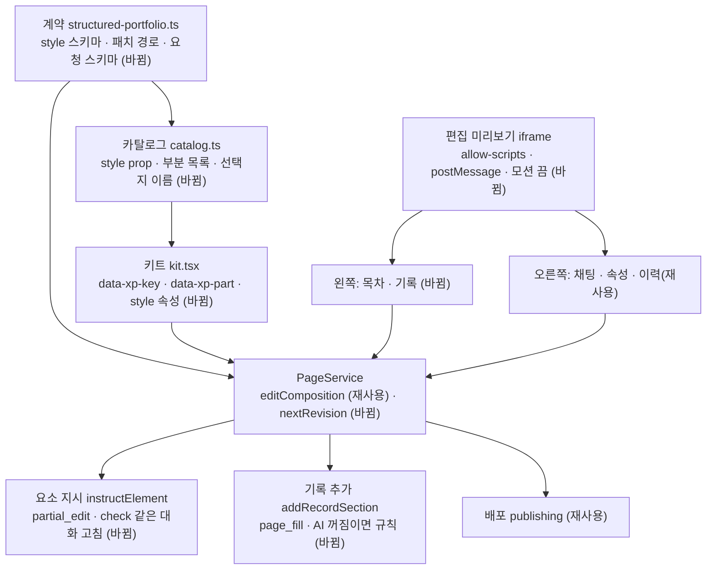

# 다듬기 화면 — 명세

## 요구사항

- [ ] 키트로 그린 지면의 요소마다 최상위 DOM에 `data-xp-key="<spec 요소 ID>"`가 붙는다. 글자 부분은 렌더러의 부분 표가 선택자로 정한다.
- [ ] 편집 미리보기에서 요소를 누르면 부모 창이 `{ key, part }`를 받는다. 배포 문서(`pageDocument`)에는 스크립트가 들어가지 않는다.
- [ ] 편집 미리보기는 `.xp-page`의 등장 애니메이션을 끈다. 배포 문서는 바뀌지 않는다.
- [ ] leaf 요소의 `props.style`에 부분별 `{ color, font, size }`를 저장한다. color는 `text|muted|accent`, font는 `display|body|mono`, size는 그 디자인 시스템 `typography.scale`의 단계 이름만 받는다. 없는 단계 이름은 422다.
- [ ] 직접 편집 패치 경로가 `period`, `quote`, `details/N/label`, `steps/N/{label,text}`, `metrics/N/{label,value,before,note}`, `profile/{role,intro}`, 섹션 `title`을 받는다. 빈 값을 보낸 선택 칸(`quote`, `period`, `before`, `note`)은 지운다.
- [ ] 편집 패널의 모양 선택지와 글자 부분 목록은 `structuredCatalog`에서 읽는다. 카탈로그에 enum prop이 있는 새 부품을 더하면 코드 수정 없이 편집 칸이 나타난다.
- [ ] `POST /v1/portfolios/:id/page/elements/:key/instruct`는 그 요소의 props · style · 묶인 글만 바꾼 새 판과 바뀐 곳 목록을 돌려준다. 다른 요소의 spec과 글은 바이트 단위로 같다.
- [ ] `POST /v1/portfolios/:id/page/sections`는 기록 하나로 섹션과 사례 요소를 만들어 최상위 연락처 앞에 넣은 새 판을 돌려준다. 이미 쓰인 기록이면 409다.
- [ ] 새 판을 만드는 모든 경로(`editComposition`, 요소 지시, 기록 추가)는 `refinement.status === "pending"`을 새 판에 옮기지 않는다.
- [ ] 세 경로 모두 `expectedRevision`이 다르면 409다.
- [ ] 편집 화면의 구조화 지면에서 「전체 배치」, 「첫 화면 원본」, 「사례 원본」 선택이 사라진다.

## 설계

**계약** (`packages/contracts/src/structured-portfolio.ts`)
- leaf 스키마에 `style: z.record(부분 이름, StructuredPartStyleSchema).optional()`를 더한다. 계약은 토큰 이름의 모양만 검사한다. 부분 이름이 그 요소에 있는지, 크기 단계가 그 디자인에 있는지는 편집 서비스가 렌더러의 부분 표(`STRUCTURED_PARTS`)와 디자인 스펙으로 검사한다. 부분은 DOM 선택자로 정의하므로 렌더러에 둔다.
- 모델 출력 스키마(`structuredModelSchema`)에는 `style`을 넣지 않는다. 생성은 지금과 같다.
- `applyStructuredTextPatches`를 경로 표(`STRUCTURED_TEXT_PATHS`) 기반으로 바꾼다. 정규식과 적용 코드가 같은 표를 쓴다.
- 요청 스키마: `InstructStructuredElementSchema { expectedRevision, instruction }`, `AddStructuredSectionSchema { expectedRevision, recordId }`. 응답은 `GeneratedPage`와 `changes: { label, before, after }[]`.

**렌더러** (`packages/portfolio-renderer`)
- json-render는 요소 키를 컴포넌트에 넘기지 않고 props를 풀어 새 객체로 넘긴다(0.21.0 `ElementRenderer`). 그래서 렌더 전에 복사한 spec의 props에 내부 키(`xpKey`)를 넣고, 감싼 레지스트리가 컨텍스트로 내려 각 컴포넌트 루트가 `data-xp-key`로 단다.
- 글자 부분은 요소 루트 기준 CSS 선택자로 정의한다(`STRUCTURED_PARTS`, 예: 사례 제목 = `.xp-head .xp-h2`). 컴포넌트 마크업에 부분 속성을 달지 않는다. `props.style`은 `[data-xp-key="k"] <선택자>{color:var(--xp-accent-text)}` 같은 규칙으로 바뀌어 `renderStructuredPortfolio`의 css 뒤에 붙는다. 편집 미리보기는 같은 선택자로 클릭한 부분을 찾는다.
- 카탈로그 각 leaf에 `style` prop과 `parts`, 선택지 표시 이름(`STRUCTURED_OPTION_LABELS`)을 더하고 `editableFields(type)`를 내보낸다.

**백엔드** (`services/backend/src/modules/page`)
- `nextRevision(latest, changes)` 하나가 새 판 문서를 만든다. pending `refinement`를 빼고 `generationJobId: null`을 넣는다. 세 경로가 이것을 쓴다.
- `instructElement`: 요소 타입 · 카탈로그 설명 · 지금 props · 묶인 글 · 허용 선택지 · 디자인 단계 이름 · 지시를 프롬프트로 보낸다. 출력은 `{ props?, style?, text?: 패치[], note }`다. `check`가 적용 후 `validateStructuredPortfolio` 위반과 `ungroundedNumbers`(근거: 그 섹션 글 + evidence 본문)를 칸 경로로 돌려준다. 클라이언트의 같은 대화 고침에 맡긴다. consent는 `partial_edit`. AI가 없으면 503 `AI_UNAVAILABLE`.
- `addRecordSection`: 기록을 DB에서 읽는다. AI가 있으면 `page_fill` 계약으로 섹션 한 개를 쓰고, `FILL_LIMITS`와 근거 검사를 `check`로 건다. AI가 없으면 제목 = 기록 제목, 요약 = 첫 문장, 본문 = 본문 평문으로 만든다. 사례 타입은 archetype이 `list`면 `CaseRow`, 아니면 `CaseEssay`다. evidence에 기록을 더한다.

**웹** (`services/web/src/app/(app)/edit/[portfolioId]`)
- `EditablePagePreview`: `pageDocument()` 결과의 `</body>` 앞에 선택 스크립트와 `.xp-page *{animation:none!important}` 를 넣는다. `sandbox="allow-scripts"`이고 `allow-same-origin`은 주지 않는다. 부모는 `event.source === iframe.contentWindow`만 받는다.
- 왼쪽: `PageOutline`(spec 순서, ↑↓, 고르기), `RecordLibrary`(기록 목록, 쓰임 표시, 추가). 화면 정의서 04의 섹션 목록 행을 따른다.
- 오른쪽: `ElementChat`(고른 요소 지시, 바뀐 곳, 되돌리기 = `restorePageAction`), `ElementProperties`(카탈로그 선택지, 글, 부분 스타일). `StructuredPageProperties`는 지운다.

## 버린 대안

- 편집기에서 spec을 클라이언트 React로 직접 그리기: 즉시 반영은 쉽지만 미리보기가 저장된 배포 HTML과 갈라질 수 있습니다. 미리보기 = 배포 문서 규칙을 지키려고 버립니다.
- 임의 hex · px 값: 디자인 시스템을 바꾸면 따라가지 않고, 명도 대비 검사(`ensureContrast`)를 우회합니다.
- 요소 지시를 지면 재생성(`page.generate`)으로 처리: 고르지 않은 요소까지 바뀝니다.

## 함정

- 이 변경 전에 저장된 판의 HTML에는 `data-xp-key`가 없습니다. 미리보기 클릭 선택은 다음 저장부터 됩니다. 목차로 고르는 것은 그 전에도 됩니다.
- `pageDocument`에는 CSP가 없습니다. 선택 스크립트는 편집 문서에만 넣고, sandbox에 `allow-same-origin`을 절대 더하지 않습니다.
- 카탈로그와 계약의 leaf 목록이 어긋나면 편집 칸이 비거나 저장이 422가 됩니다. 두 목록의 일치를 테스트로 묶습니다.
- `editComposition`은 지금 직전 판의 `qualityStatus`를 복사합니다. 이 동작은 그대로 둡니다.
- 다른 세션이 키트에 부품을 더하므로 `kit.tsx` · `catalog.ts`는 병합 충돌이 날 수 있습니다. PR 전에 origin/main을 병합합니다.

## 완료 기준

- `pnpm typecheck`, `pnpm test`, `pnpm test:infra`가 통과합니다.
- `refine.localhost:3201`에서 요소 클릭 선택 → AI 지시(fixture 공급자) → 되돌리기 → 직접 스타일 저장 → 목차 순서 변경 → 기록 추가 → 미리보기 새 창 → 배포 후 공개 지면 반영을 확인하고 스크린샷을 남깁니다.
