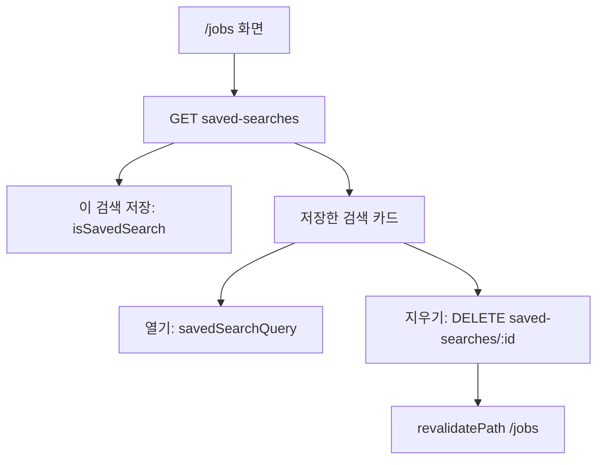

# 저장한 검색 조건 반영과 목록 — 명세

## 요구사항

1. `jobs/saved-search.ts`
   - `conditionsKey`: `field=value(:off)`를 정렬해 이은 키. 확신도 · 순서는 보지 않는다.
   - `isSavedSearch(saved, query, conditions)`: 문장과 키가 모두 같을 때 true.
   - `savedSearchQuery(search)`: `q`와 칩 파라미터(`CHIP_AXIS_PARAM`). 켠 조건은 값, 끈 조건은 `off`. 칩이 없는 필드(연봉 · 규모)는 뺀다.
   - `ChipAxis` · `CHIP_AXIS_PARAM`을 `page.tsx`에서 옮겨 온다.
2. `page.tsx`: 저장 목록을 검색어가 없어도 받는다. `searchSaved`는 `isSavedSearch`, `SaveSearchButton`의 `key`는 문장 + `conditionsKey`.
3. `SavedSearches`(클라이언트): `SearchRail` · `BrowseRail` 끝에 둔다. 저장이 없으면 그리지 않는다.
4. `DELETE /v1/jobs/saved-searches/:id` → 204, 남의 것 · 없는 것 404. Mongo · MySQL 서비스 모두 `deleteSavedSearch`.
5. 웹 `deleteSavedSearchAction`: 404는 지운 것으로 보고, 지운 뒤 `revalidatePath("/jobs")`.

## 설계

## Open questions

없음.
