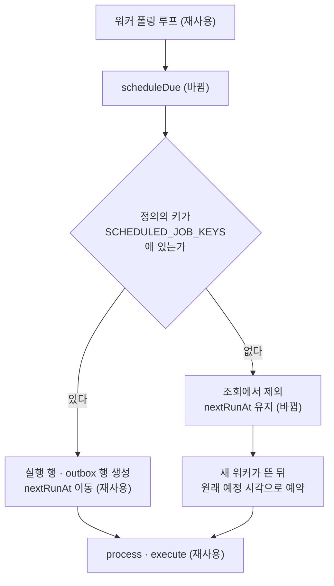

# 배포 중 새 예약 작업의 첫 실행 보존 — 명세

## 확인한 원인

- `scripts/operations/deploy.sh`는 92행에서 `pnpm db:migrate`를 돌리고, 백엔드 빌드(94행)와 웹 빌드(111행)를 지난 126행에서 `expresso-worker`를 재시작한다. 그 사이 옛 워커가 계속 돈다.
- `services/backend/src/worker/main.ts`의 폴링 루프는 `outboxPollIntervalMs` 주기마다 `schedulingService.scheduleDue()`를 부른다.
- `SchedulingService.scheduleDue`(`services/backend/src/modules/scheduling/service.ts`)는 `nextRunAt <= 지금`인 정의를 키와 관계없이 모두 집는다. 실행을 만드는 같은 트랜잭션에서 `nextRunAt`을 `intervalSeconds` 뒤로 옮긴다.
- `process`는 `#execute`를 부르고, `#execute`는 모르는 키에서 `unsupported scheduled job key`를 던진다. BullMQ가 다섯 번 재시도한 뒤 실행은 `failed`로 남는다. `nextRunAt`은 이미 옮겨져 있다.

## 요구사항

- [ ] `scheduleDue`는 서비스가 아는 키의 정의만 집는다. 모르는 키의 정의는 `scheduled_job_runs` 행과 `scheduled.execute` outbox 행을 만들지 않고 `nextRunAt`을 바꾸지 않는다.
- [ ] 아는 키의 정의는 지금과 같이 예정 시각마다 한 번만 예약된다.
- [ ] 모르는 키를 건너뛴 뒤 그 키를 아는 서비스가 `scheduleDue`를 돌리면 `scheduledFor`가 원래 `nextRunAt`인 실행이 한 건 생긴다.
- [ ] `docs/operations/DEPLOYMENT.md`에 배포 뒤 `scheduled_job_runs` 확인과 이 수정의 적용 시점을 적는다.

## 설계

- `scheduleDue`의 `find` 조건에 `_id: { $in: 아는 키 }`를 더한다. 아는 키의 출처는 기존 `SCHEDULED_JOB_KEYS`(`scheduling/public.ts`)다. 이 배열은 `#execute`의 분기와 `satisfies never`로 묶여 있어 「처리할 줄 아는 키」와 같다.
- `SchedulingService` 생성자의 `dependencies`에 `keys`를 더한다. 기본값은 `SCHEDULED_JOB_KEYS`다. 시험이 일부 키를 뺀 서비스를 만들어 옛 워커를 재현한다. 기존 `overrides`와 같은 주입 방식이다.
- `process`와 `#execute`는 바꾸지 않는다. 이미 만들어진 실행이 모르는 키를 가리키면 지금처럼 실패로 드러난다.
- `public.ts`의 주석 「어긋나면 스케줄러가 모르는 키를 집어 든다」를 바뀐 동작에 맞게 고친다.
- `legacy-mysql-service.ts`는 워커가 쓰지 않으므로 건드리지 않는다.

## 버린 대안

- **배포 스크립트가 마이그레이션 전에 워커를 멈추기.** 마이그레이션(92행)과 워커 재시작(126행) 사이에 백엔드 빌드와 웹 빌드가 있어, 그동안 큐 소비자가 꺼지고 사용자의 생성 · 분석 작업이 대기한다. `set -e`라 마이그레이션이나 빌드가 실패하면 워커가 멈춘 채로 스크립트가 끝난다. 코드만 이전 커밋으로 되돌린 경우와 손으로 `pnpm db:migrate`를 돌린 경우는 막지 못한다.
- **마이그레이션이 `nextRunAt`을 미래 시각으로 넣기.** 배포가 끝나는 시각을 알 수 없어 근거 없는 대기 시간 상수가 필요하다.
- **건너뛴 키를 로그로 남기기.** 폴링이 1초 주기라 같은 줄이 계속 찍힌다. 밀린 정의는 `status()`의 `lagMs`로 이미 보인다.

## 함정

- 이 필터는 이 변경이 배포된 뒤의 워커부터 적용된다. 지금 운영에서 도는 워커에는 없다. 이 변경과 새 예약 작업이 같은 배포에 실리면 그 배포는 보호되지 않는다.
- `scheduled_job_definitions`에는 `_id`를 키 목록으로 제한하는 strict 검증 규칙이 있다. 시험이 임의의 키를 넣지 않고 서비스의 `keys`를 줄여 재현하는 이유다.
- 코드를 이전 커밋으로 되돌리면 모르는 키의 정의는 실행되지 않은 채 `lagMs`만 커진다. 의도한 동작이다.
- 통합 시험은 `TEST_MONGODB_URL`이 없으면 건너뛴다. `pnpm test:infra` 출력에서 새 시험이 실제로 실행됐는지 확인한다.

## 완료 기준

- `pnpm typecheck`, `pnpm test`, `pnpm test:infra`가 통과한다.
- `pnpm test:infra` 출력에 새 시험이 `skipped`가 아닌 통과로 찍힌다.
