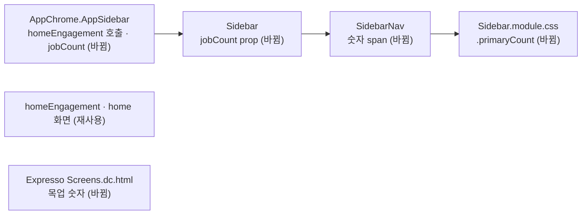

# Spec — 사이드바 공고 탐색 숫자 제거

## 요구사항

1. `SidebarNav`가 「공고 탐색」 행에 숫자 ``을 그리지 않는다.
2. `jobCount` prop이 `AppChrome` → `Sidebar` → `SidebarNav` 경로에서 사라진다.
3. `AppSidebar`가 `homeEngagement`를 부르지 않는다. 포트폴리오와 관심 공고 조회는 그대로다.
4. 쓰는 곳이 없어진 `.primaryCount` 스타일을 지운다.
5. 화면 정의서 목업의 「공고 탐색」 행에서 숫자 ``을 지운다. 라벨의 `flex: 1`은 유지한다.

## 설계

## 함정

- `homeEngagement`는 홈 · 새 포트폴리오 · 온보딩이 계속 쓴다. `app-data`의 함수는 지우지 않는다.
- 숫자가 사라지면 `.primaryLabel`의 `flex: 1`이 행 폭을 채우므로 레이아웃은 변하지 않는다.
- 버린 대안: 숫자를 전체 공고 수로 바꾸는 방법. 사이드바가 목록 API를 매 화면 부르게 되고, 요청에 없다.
