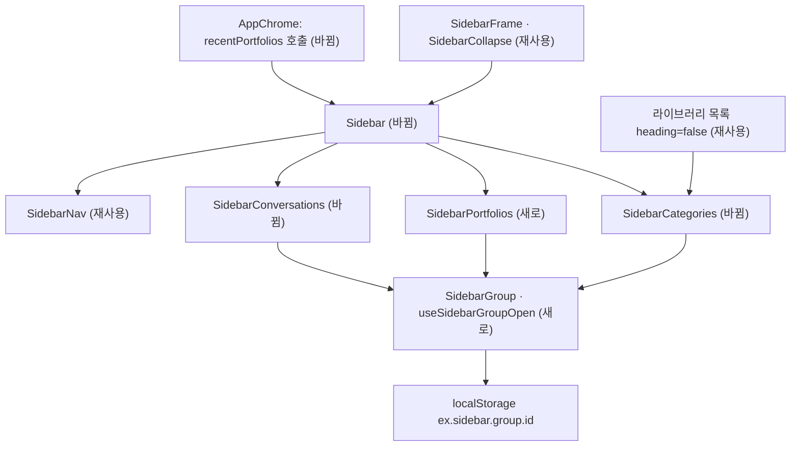

# 사이드바 포트폴리오 · 커리어 기록 묶음과 묶음별 접기 — 명세

## 요구사항

- [ ] `Sidebar`가 `SidebarNav` 아래에 최근 대화 → 포트폴리오 → 커리어 기록 순으로 묶음을 세운다.
- [ ] 포트폴리오 묶음은 라이브러리와 같은 `gridItems(home.activeBrews, portfolios.list(limit 5))` 앞 다섯 칸이다. 제작은 `resumeStep` 단계로, 포트폴리오는 `/edit/{id}`로 간다. 0건이면 세우지 않는다. 다섯 칸을 넘거나 `page.hasNextPage`면 `/library?s=portfolios`로 가는 「모두 보기」 줄을 붙인다.
- [ ] 커리어 기록 묶음은 `session.categories`를 `SidebarCategories`로 그리고 `/career/{key}`로 간다. 카테고리 추가 `+`와 「보관됨」이 동작한다.
- [ ] 묶음 머리말은 `aria-expanded` · `aria-controls`를 가진 버튼이다. 누르면 본문이 `grid-template-rows` 1fr↔0fr로 접히고 펼쳐진다.
- [ ] 접힌 본문은 `inert`라 포커스와 클릭이 닿지 않는다.
- [ ] 접힘은 `localStorage` `ex.sidebar.group.{id}`에 저장한다. 새로고침 첫 페인트는 루트 레이아웃 `<head>`의 `SIDEBAR_GROUPS_BOOTSTRAP`이 접고(하이드레이션 전 `data-animated="false"`에만 적용), 하이드레이션 뒤에는 `data-open`이 이어받는다. 복원할 때는 전환을 켜지 않는다.
- [ ] 카테고리 `+`를 누르면 접힌 커리어 기록 묶음이 펼쳐진다.
- [ ] 레일(사이드바 전체 접힘)에서는 머리말이 높이째 접히고 탭 순서에서 빠진다. 펼친 포트폴리오 · 카테고리 묶음은 아이콘만 남는다. 최근 대화는 지금처럼 레일에서 물러난다.
- [ ] 전역 `a:hover`가 클래스로 글자색을 정한 링크를 덮어쓰지 않는다. 「새 포트폴리오」(`.brew` · `.brewCta` · `.materialsCta`) 호버 글자색이 `--ex-fg-on-accent`로 남는다.
- [ ] 전역 규칙에 기대 호버 때 진해지던 흐린 링크(설정 `navItem` · `a.dataAction`, 탐색 `a.headAction` · `pagerPage` · `pagerArrow` · `listRow`, 라이브러리 `listRow`)는 자기 `:hover`에 `--ex-fg-strong`을 적어 지금 모습을 유지한다.
- [ ] 라이브러리 왼쪽 목록(`SidebarCategories heading={false}`)은 그대로다.

## 설계

재사용:
- `SidebarCollapse.tsx`의 `useBeforePaint` 패턴과 첫 프레임 뒤 전환 켜기 방식을 묶음 접힘에 그대로 쓴다. 1024 미만에서 강제로 펼치는 로직은 가져오지 않는다. 묶음 접기는 서랍에서도 유지된다.
- `4819fd0e`에서 지운 사이드바 포트폴리오 마크업, `AppChrome`의 포트폴리오 매핑, `lib/app-data.ts`의 `recentPortfolios`를 되살린다. `Sidebar.module.css`의 `.portfolios` · `.portfolioItem` · `.thumb*` · `.draftChip`은 아직 남아 있다.
- 묶음 이름은 라이브러리 `KIND_LABEL`의 "포트폴리오", "커리어 기록"과 맞춘다.

새로 만드는 것:
- `components/shell/SidebarGroup.tsx` (클라이언트)
  - `useSidebarGroupOpen(id)`: `{ open, animated, setOpen }`. 저장 · 복원을 맡는다.
  - `SidebarGroupView`: 머리말(토글 버튼 + 화살표 + `actions`)과 본문을 그린다. 열림 상태를 props로 받는다.
  - `SidebarGroup`: 훅과 뷰를 묶는다. 최근 대화와 포트폴리오가 쓴다.
- `SidebarCategories`의 `heading` 분기는 훅과 `SidebarGroupView`를 직접 쓴다. `+`가 `setOpen(true)`를 함께 부르기 때문이다.
- `SidebarPortfolios.tsx` (클라이언트 — 활성 줄을 주소로 정하고 `SidebarGroup`을 쓴다): 포트폴리오 · 제작 줄과 「모두 보기」. 제작 줄은 주소 끝 단계가 바뀌므로 `/brew/{id}` 전체에 활성 표시를 건다.
- `sidebar-group-storage.ts` (클라이언트 지시어 없음): 저장 키 접두어와 `SIDEBAR_GROUPS_BOOTSTRAP`. 루트 레이아웃이 `THEME_BOOTSTRAP` 옆에 둔다.
- CSS: `.group`, `.groupToggle`, `.groupCaret`, `.groupBody`, `.groupBodyInner`. 첫 묶음 위 간격은 `nav + .group .groupHeadRow { padding-top: 0 }`으로 정한다. `groupHeadFirst`를 특정 묶음에 고정하지 않는다.

호버 글자색: `styles/global.css`의 `a:hover`(0,1,1)가 `.brew`(0,1,0)보다 강해 `--ex-fg-strong`으로 덮어썼다. 규칙을 `a:where(:hover)`(0,0,1)로 바꿔 `a`와 같은 우선순위로 내린다. 클래스로 색을 정하지 않은 링크만 이 규칙을 받는다. `.brew:hover`에 색을 한 번 더 적는 국소 수정은 같은 문제를 가진 다른 링크 버튼을 그대로 둔다.

## 버린 대안

- `SidebarCollapseProvider`를 묶음마다 재사용: 1024 미만에서 강제로 펼치므로 서랍에서 묶음 접힘이 풀린다.
- 커리어 줄을 `/library?s={key}`로: 홈 · 명령 팔레트 · 공고 · 브루 화면이 모두 `/career/{key}`로 보낸다.
- 접힘을 쿠키로 저장해 서버 렌더에 반영: 저장 위치가 하나 더 생기고, 사이드바는 Suspense 뒤에서 스트리밍되므로 첫 페인트 전 복원으로 충분하다.

## 함정

- 레일에서 `.groupHead`는 높이만 0이라 버튼이 탭 순서에 남는다. `visibility: hidden`으로 뺀다(`.quotaCard`와 같은 방식).
- 본문을 `overflow: hidden`으로 접으면 줄의 포커스 링(3px)이 잘린다. 안쪽에 3px 패딩과 −3px 여백을 둔다.
- 사이드바는 레이아웃이라 화면 이동으로 다시 받지 않는다. 포트폴리오 목록 갱신은 4-탭 이전과 같은 `router.refresh()` 경로에 기댄다.
- `SidebarConversations`는 대화가 0건이면 `null`이다. 묶음 간격을 그 존재에 묶지 않는다.

## 완료 기준

- `pnpm --filter @expresso/web typecheck`와 `vitest run src/components/shell`이 통과한다.
- 로컬 웹에서 세 묶음이 보이고, 접은 묶음이 새로고침 뒤에도 접혀 있고, 레일과 서랍(375px)이 깨지지 않는다.
