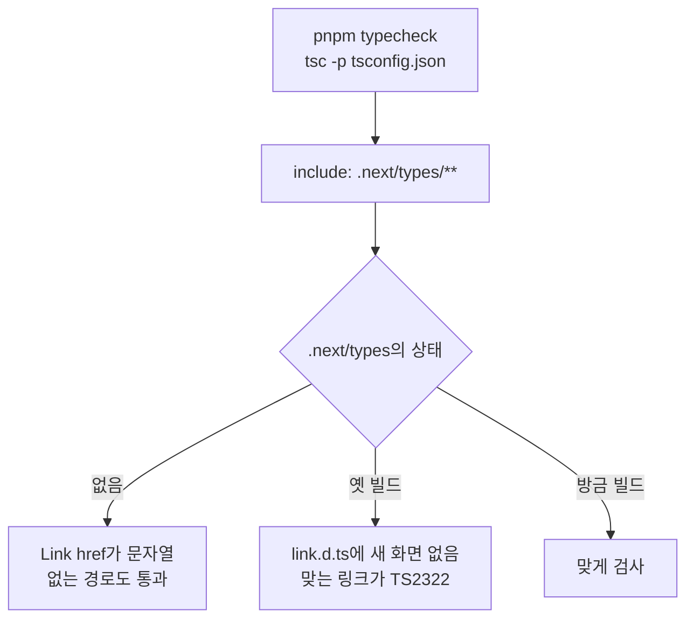
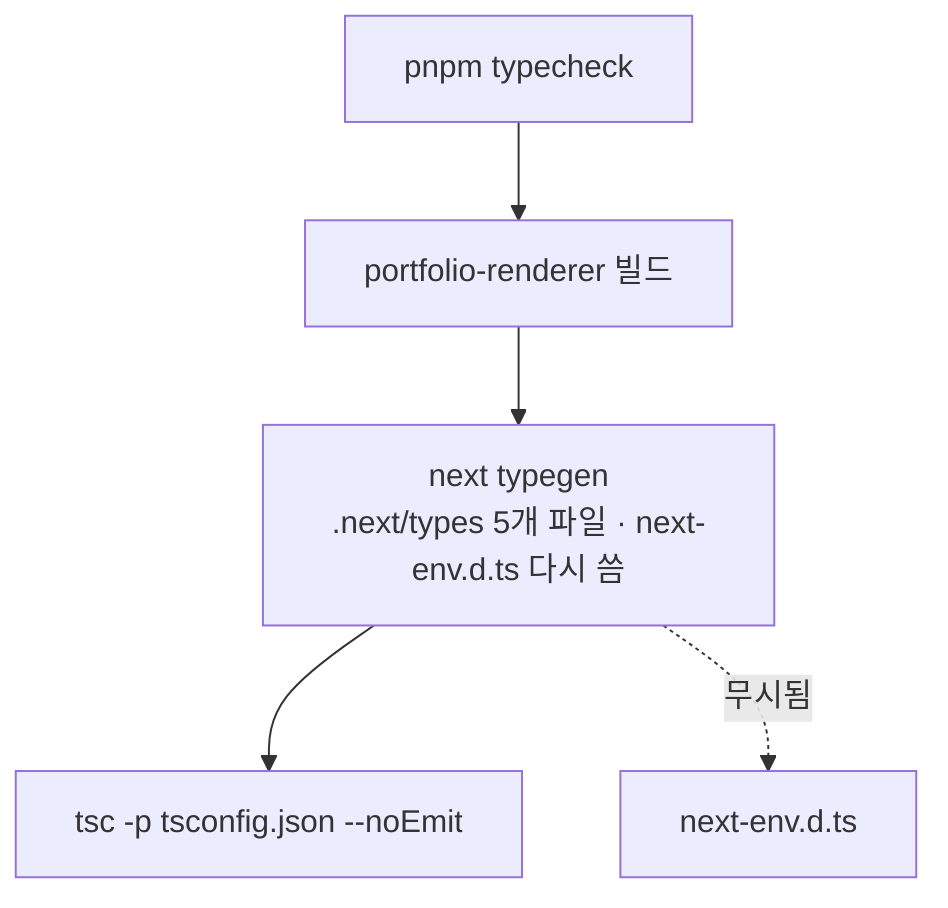

# 타입 검사의 경로 타입 생성 — 명세

## 요구사항

1. 웹의 `typecheck` 스크립트는 `tsc`보다 먼저 `next typegen`을 돌린다.
2. `services/web/next-env.d.ts`는 저장소가 추적하지 않고 `services/web/.gitignore`가 무시한다.
3. `scripts/operations/deploy.sh`는 `next-env.d.ts`를 가리키는 git 명령을 두지 않는다.
4. `deploy.sh`의 git 구간(fetch 뒤 ~ 재시작)은 추적하던 커밋과 추적하지 않는 커밋 사이를 어느 방향으로 오가도 멈추지 않는다.

## 지금의 동작

- `.next/types/link.d.ts`가 `<Link href>`의 타입을 좁힌다. 이 파일이 없으면 `href`는 `string | UrlObject`다.
- `link.d.ts` · `validator.ts`를 만드는 것은 `next dev`(→ `.next/dev/types`), `next build`, `next typegen`뿐이다. `tsc`는 만들지 않는다.
- CI(`web-ci.yml`)는 타입 검사 → 테스트 → 빌드 순서라, 타입 검사 단계에는 `.next`가 없다.

## 설계

- **`services/web/package.json`**: `typecheck`를 `pnpm --filter @expresso/portfolio-renderer build && next typegen && tsc -p tsconfig.json --noEmit`로 바꾼다. 근거: `next/dist/docs/01-app/03-api-reference/06-cli/next.md` 「`next typegen` options」 — `next typegen && tsc --noEmit`.
  - `next typegen`은 `routes.d.ts` · `link.d.ts` · `validator.ts` · `cache-life.d.ts` · `root-params.d.ts`를 `<distDir>/types`에 다시 쓴다(옛 파일 위에 돌려 확인, 1초). 설정은 운영 빌드 phase로 읽으므로 `NEXT_DIST_DIR` 없이 돌면 `.next/types`다.
- **`services/web/next-env.d.ts`**: `git rm --cached`. **`services/web/.gitignore`**: `next-env.d.ts` 추가. 근거: `05-config/02-typescript.md` 「`next-env.d.ts`」 — "Add it to `.gitignore`. If your project already tracks the file, remove it from Git."
- **`scripts/operations/deploy.sh`**: `git checkout -- services/web/next-env.d.ts`와 그 주석을 지운다.
- **`services/web/src/tsconfig.test.ts`**: `typecheck` 스크립트에서 `next typegen`이 `tsc`보다 앞에 있는지 본다.
- **`AGENTS.md` · `docs/operations/DEPLOYMENT.md`**: 타입 검사가 경로 타입을 새로 만든다는 것과 `next-env.d.ts`를 추적하지 않는다는 것을 적는다.

## 배포 스크립트의 git 구간

`deploy.sh`는 서버에 있는 커밋(지금 배포된 판)의 스크립트로 시작해, `git checkout --detach` 뒤 목표 커밋의 스크립트로 다시 시작한다. 되돌리기 줄은 재시작 분기보다 앞에 있어 두 번 다 돈다.

| 경로 | 1차(지금 판의 스크립트) | checkout | 2차(목표 판의 스크립트) |
|---|---|---|---|
| 첫 배포: 추적 → 미추적 | 되돌리기 줄이 빌드가 고친 파일을 되돌림 | 파일 삭제 | 줄이 남아 있으면 pathspec 오류로 멈춤 → 지운다 |
| 보통 배포: 미추적 → 미추적 | 줄 없음 | 무시된 파일 그대로 | 줄 없음 |
| 되돌리기: 미추적 → 추적 | 줄 없음 | 무시된 파일을 git이 덮어씀(`--overwrite-ignore` 기본값) | 옛 줄: 방금 checkout한 파일이라 변화 없음 |
| 다시 앞으로: 추적 → 미추적 | 옛 줄이 되돌림 | 파일 삭제 | 줄 없음 |

## 버린 대안

- `next-env.d.ts`를 추적한 채 `typecheck` 뒤에 `git checkout`으로 되돌림: 검사가 작업 폴더의 git 상태를 건드리고, 개발 서버가 같은 파일을 다시 쓴다.
- `deploy.sh`의 줄을 `git ls-files --error-unmatch … && git checkout …`으로 남김: 2차 실행에서는 방금 checkout한 파일이라 항상 할 일이 없고, 1차 실행에서 필요한 경우는 그 판의 스크립트가 맡는다. 남길 이유가 없다.
- `tsconfig.json`의 `include`에 `.next/dev/types/**`를 더해 개발 서버의 타입을 읽음: `.next/types`와 함께 들어와 선언이 겹친다.
- CI에서 빌드를 타입 검사보다 먼저 돌림: 로컬의 `pnpm typecheck`는 그대로 남는다.

## 함정

- `next typegen`은 `next.config.ts`를 운영 빌드 phase로 읽는다. `NEXT_DIST_DIR`을 준 채 돌리면 #247의 `buildTsconfig`가 `tsconfig.<폴더>.json`을 찾는다.
- 무시된 파일을 git이 덮어쓰는지는 git의 기본값에 달려 있다. 실제 커밋으로 실험하고, 서버의 git 판도 확인한다.
- 고친 뒤 통과만 보면 "새 타입을 읽음"과 "타입을 안 읽음"을 가를 수 없다. 없는 경로의 링크가 실패하는 장면을 함께 본다.

## 완료 기준

intent의 「개발 목표」 여섯 줄.
