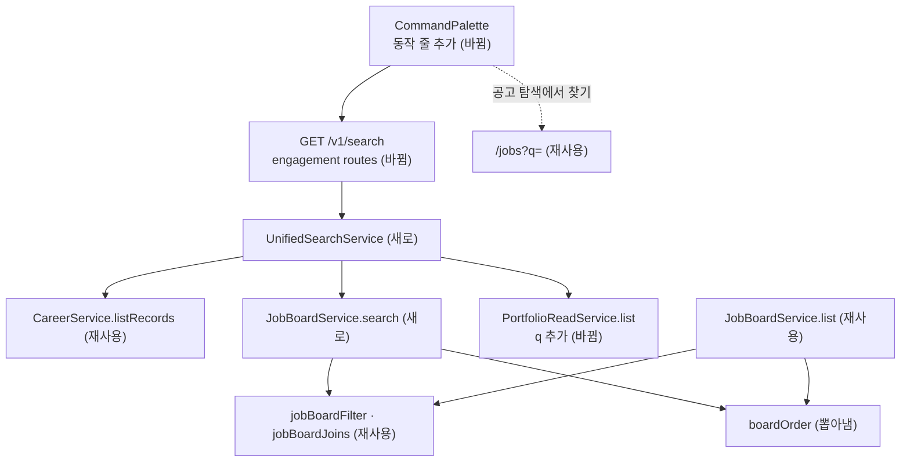

# 통합 검색 공고 검색 규칙 일원화 — 명세

## 요구사항

- [ ] `GET /v1/search`의 공고는 `jobBoardFilter`(`jobs/mongo-queries.ts`)와 같은 조건으로 거른다 — 열린 공고, 제목 · 회사 이름 · 본문 부분 일치.
- [ ] 공고 탐색이 아무것도 안 고른 첫 화면에 거는 나라(한국)를 검색창도 건다. 그 값은 웹 한 곳(`lib/job-search-defaults.ts`)에 두고, 검색창이 `country`로 넘긴다.
- [ ] 공고 순서는 공고 탐색의 기본 정렬(`sort: "match"`)과 같다. 정렬 단계도 `JobBoardService.list`와 같은 함수에서 나온다.
- [ ] 기록은 `CareerService.listRecords(userId, { q, sort: "title_asc", limit })`로 찾는다.
- [ ] 포트폴리오는 `PortfolioReadService.list(userId, { q, limit })`로 찾는다. `ListPortfoliosQuerySchema`에 `q`(제목 부분 일치, 대소문자 무시)를 더한다.
- [ ] `limit`은 종류마다 적용한다. 기본 20, 최대 50(기존 값 그대로).
- [ ] `cursor`를 계약에서 뺀다. 응답은 `UnifiedSearchResponseSchema = { data }`로 계약에 둔다. 웹이 손으로 적은 응답 스키마를 지운다.
- [ ] `engagement` 모듈은 다른 모듈의 컬렉션을 직접 읽지 않는다. 다른 모듈 파일을 직접 가져오지도 않는다.
- [ ] 검색창 결과 끝에 `/jobs?q=`로 가는 동작 줄이 있고, ↑↓ · Enter로 고를 수 있다.
- [ ] 다른 사용자의 기록 · 포트폴리오는 나오지 않는다.

## 설계

- **재사용**: `jobBoardFilter` · `jobBoardJoins`(공고 규칙), `listMongoRecords`의 제목 검색(기록 규칙), `PortfolioReadService.list`(포트폴리오 목록), 화면의 `SEARCH_GROUPS` · 결과 줄 스타일.
- **jobs**: 정렬 단계 만드는 부분을 `boardOrder(query, at)`로 `board-service.ts` 안에서 뽑고 `list`도 그것을 쓴다. `JobBoardService.search(userId, { q, country, limit })`를 더한다. `[...jobBoardJoins, { $match: jobBoardFilter(query, at) }, ...boardOrder, { $limit }]`로 데이터만 읽고 `{ id, title, company }`를 돌려준다. 패싯은 계산하지 않는다.
- **engagement**: `search.ts`에 `UnifiedSearchService`를 새로 둔다. 생성자는 세 출처를 구조 타입으로 받는다(`records.listRecords`, `jobs.search`, `portfolios.list`). 셋을 `Promise.all`로 부르고 `UnifiedSearchItem`으로 바꾼다. `EngagementService.search`와 그 커서 함수, 레거시 MySQL 구현의 `search`를 지운다.
- **조립**: `api/main.ts`가 `new UnifiedSearchService({ records: careerService, jobs: jobBoardService, portfolios: portfolioReadService })`를 만든다. `buildApi`는 `unifiedSearchService` 옵션을 받아 `registerEngagementRoutes`에 넘기고, 라우트는 그 옵션이 있을 때만 `/v1/search`를 연다.
- **계약**: `UnifiedSearchQuerySchema.country`는 `ListJobPostingsQuerySchema.shape.country`를 그대로 쓴다.
- **웹**: `jobs/page.tsx`의 `DEFAULT_COUNTRY`를 `lib/job-search-defaults.ts`의 `DEFAULT_JOB_COUNTRY`로 옮기고, `palette-actions.ts`가 그 값을 넘긴다. `endpoints.ts`가 계약의 `UnifiedSearchResponseSchema`를 쓴다. `CommandPalette`는 결과 끝에 동작 줄(종류 표시 `ACTION`)을 더하고, 키보드 순회 목록에도 넣는다. 자리표시 글은 「기록 · 공고 · 포트폴리오 찾기」로 고친다(공고는 제목만 보지 않는다).

## 버린 대안

- `JobBoardService.list`를 그대로 부르기: 같은 결과지만 입력할 때마다 나라 · 회사 · 기술 패싯 집계를 모든 공고에 돌린다.
- 검색창에서 공고 탐색의 문장 해석(`/jobs/search/interpret`)까지 부르기: 해석이 최근 검색을 저장하고 AI를 쓸 수 있어 입력마다 부를 수 없다.
- `EngagementService` 생성자에 출처를 선택 인자로 넣기: Worker와 `scheduling`이 출처 없이 만들어서, 빠뜨리면 실행 중에야 드러난다.

## 함정

- `jobBoardFilter`의 회사 이름 조건은 `jobBoardJoins`가 붙인 `company.name`을 본다. 조인보다 먼저 `$match`를 두면 회사 이름 검색이 깨진다.
- 공고 탐색의 기본 나라는 백엔드가 아니라 웹 화면에 있다. 검색창이 나라를 넘기지 않으면 해외 법인 공고가 섞여 공고 탐색과 순서가 달라진다(검증 서버에서 확인).
- `listRecords`는 `summary` 패싯과 관계 조회까지 한다. 사용자 한 명 범위라 감당하지만 `limit`을 꼭 넘긴다.
- `security-gate.test.ts`는 `/v1/search`가 401을 내는지 본다. 라우트 등록 조건이 바뀌므로 테스트 앱에도 `unifiedSearchService`를 넣는다.
- 웹은 응답을 계약으로 파싱한다. `page`를 빼는 변경은 백엔드와 웹이 같은 커밋에 들어가야 한다.

## 완료 기준

- `pnpm typecheck` · `pnpm test` 통과.
- `pnpm test:infra`에서 새 통합 테스트(회사 이름으로 공고 찾기, 점수 없는 공고, 마감 공고 제외, 소유자 범위)가 통과.
- 개발 서버의 검색창에서 회사 이름으로 공고가 나오고, 동작 줄이 `/jobs?q=`로 간다.
