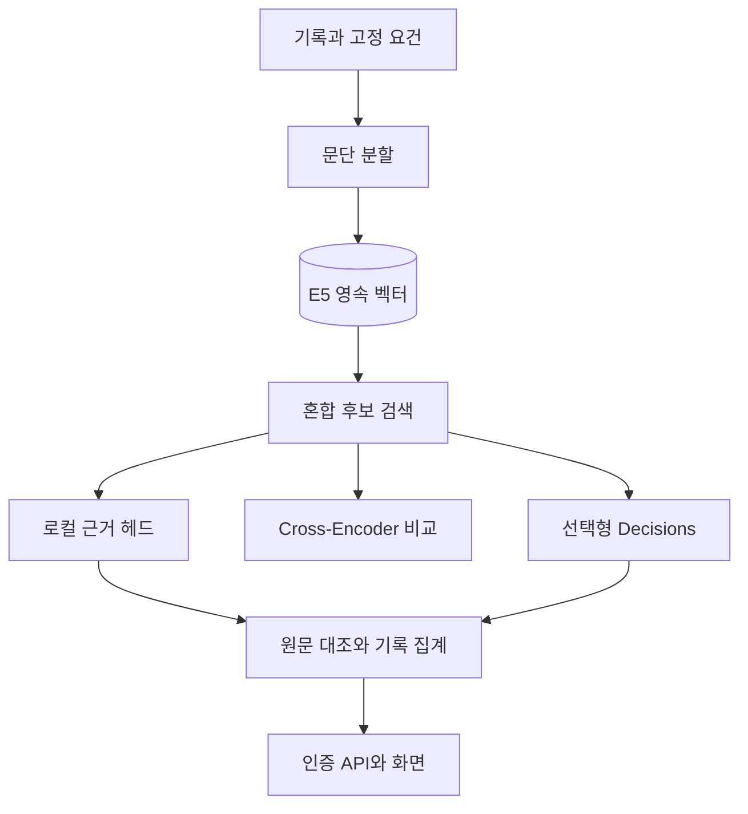

# 요건별 근거 검색 v2

기록을 문단으로 검색하고 같은 기록의 결과를 합쳐 원문 인용을 반환한다. 공고 순위 모델 A의 가중치·입력과 외부 공고 재정렬 경로는 v1을 유지한다.

## 검색과 제품 연결

- 제목·Markdown 절·문단·속성을 검색 단위로 사용한다. 긴 문단은 문맥을 포함해 384토큰 창으로 나누고 최대 32토큰을 겹친다. E5 입력 한도는 512토큰이다.
- 문단마다 기록 ID, 원문 필드, Unicode 코드 포인트 시작·끝 위치를 보존한다. 속성에는 `propertyKey`를 붙인다.
- 학습 근거 점수·코사인·BM25 순위를 RRF로 결합해 기본 24개 기록을 고른다. BM25 일치가 없는 0점 항목은 결합에서 제외한다. RRF 상수는 60으로 고정했다.
- 기록별 최고 문단 점수를 사용하고 같은 기록은 한 번만 반환한다. 후보마다 학습 점수와 융합 점수의 최고 문단을 최대 두 개 보존한다. 로컬 근거 헤드·Cross-Encoder·Decisions는 이 문단 집합을 공통으로 사용한다.
- 인증 API는 본인의 유효한 기록만 반환한다. 인용은 원문의 해당 위치와 문자열이 같은 경우에만 표시한다. 웹은 기록 링크 아래에 인용을 표시하고 HTML을 실행하지 않는다.
- `local`·`rerank` 모드는 기존 공고 순위를 계산한다. `evidence`·`verify` 모드와 제작 재료 추천에서 문단 검색을 적용한다. 전체 공고의 배치 순위 계산마다 문단 검색을 반복하지 않는다.



벡터는 기존 SQLite 저장소를 재사용한다. 변경 스트림 체크포인트에 `record-passages-v2`를 붙여 v1 체크포인트가 있어도 문단 준비를 시작한다. 기존 벡터는 입력 해시가 같으면 재사용한다. 기록 변경·삭제 시 같은 소유자의 참조를 갱신한다. 큰 토크나이저는 부팅 때 검색 전용 인스턴스를 만들고 요청 중에는 읽기만 한다.

## 학습

E5 인코더를 고정하고 두 경로를 학습했다. 한국어 train으로 학습하고 valid로 선택했다. 평가 공고·프로필과 더미 계정은 학습에서 제외했다.

| 경로 | 학습과 선택 |
| --- | --- |
| 로컬 근거 헤드 | 기존 헤드가 높은 점수를 준 미연결 기록에서 hard negative를 채굴한다. 기록별 문단 logit의 최댓값에 BCE를 적용한다. 모든 문단을 양성으로 처리하지 않는다. 학습 기록 쌍 35,757개, 채굴된 어려운 음성 쌍 17,767개. 한국어 valid 1,281요건의 MRR로 2 epoch를 선택했다. |
| Cross-Encoder | 기존 학습 BGE 체크포인트에서 마지막 두 층과 classifier를 조정했다. 기록 12,000쌍·문단 24,000쌍을 사용했다. 기록당 최대 두 문단의 최고 logit에 BCE를 적용한다. 96개 valid 요건의 MRR@3로 2 epoch를 선택했다. |

미연결 기록은 교사 정답표의 누락을 포함한다. 채굴된 음성의 loss 비중을 0.5로 줄였으며, 대체 근거를 사람이 독립적으로 검수하지 않았다. 같은 벡터를 가진 정답 복제 기록은 음성 채굴에서 제외한다.

5080 PC에서 학습·Cross-Encoder 비교를 실행했다. CPU 배포본은 로컬 근거 헤드를 ONNX로 변환한다. 정규화된 임의 입력의 동적 모양 세 가지에서 PyTorch와 ONNX 최대 절대차는 `1.34e-5`였다. Cross-Encoder는 비교용 체크포인트로 보관하며 CPU 서비스에는 로드하지 않는다.

## 동일 후보 비교

평가 기준은 고정된 교사·에이전트의 기록 ID 정답이다. Hit@3는 근거가 있는 요건 중 상위 기록 3개에 정답이 한 개 이상 있는 비율이다.

| 방식 | 한국어 표본 44요건 | 더미 6계정 153요건 |
| --- | ---: | ---: |
| v1 기록 단위 로컬 | 90.9% | 45.8% |
| 문단 검색 + hard negative 로컬 헤드 | 93.2% | 51.0% |
| 기존 학습 Cross-Encoder 전이 적용 | 79.5% | 41.8% |
| 요건·문단 추가 학습 Cross-Encoder | 90.9% | 54.9% |
| 같은 후보의 Decisions | 86.4% | 76.5% |

한국어 표본은 최종 평가의 256요건 중 근거가 있는 44개다. 더미 계정은 258요건 중 153개에 근거가 있다. valid 96개를 포함한 총 610개 평가 행에서 요건·기록 후보·문단 원문·위치·소유권이 같은지 대조했다. v1 기록 단위 기준선을 제외한 재정렬 비교는 같은 24개 이하의 기록과 같은 문단을 사용한다.

Decisions는 610개 실제 요청에서 재시도 없이 완료됐다. 호출 p50은 374ms, p95는 528ms였으며 한 요청은 요건 하나와 여러 후보 문단을 포함한다. 공고 하나의 제품 응답 전체 지연과는 범위가 다르다. 코드에 설정된 단가로 계산한 추정 비용은 $0.292다.

외부 검증은 선택형으로 유지한다. 한국어 평가 표본에서는 로컬보다 낮았다. 인용의 원문 일치와 기록 정답 회수율을 확인했으며, 인용문 자체가 요건을 입증하는지는 사람의 문장 단위 정답으로 평가하지 않았다. `shownReferencePrecision`은 알려진 정답 기록과의 일치율이며 누락된 대체 근거를 포함한 실제 정밀도로 해석하지 않는다.

## 후보 수와 Oracle CPU 지연

| 후보 상한 | 더미 정답 포함률 | Oracle 로컬 p50 | p95 |
| --- | ---: | ---: | ---: |
| 12 | 81.0% | 16.4ms | 65.7ms |
| 24 | 92.8% | 13.8ms | 56.5ms |
| 48 | 97.4% | 13.6ms | 56.5ms |

고정 공고 1개·기록 수가 다른 더미 6계정·3회 반복으로 상한마다 18개 순차 요청을 측정했다. Oracle ARM64에서 단일 코어·추론 1스레드·낮은 프로세스 우선순위를 사용했다. 영속 벡터 4,020개를 복원했고 새 인코딩은 0건이었다. 인증 API와 네트워크는 포함하지 않았다. 후보 수별 실행 순서와 적은 표본 때문에 작은 시간 차이로 우열을 정하지 않는다. API 후보 48개 경로는 측정하지 않았다.

요청마다 토크나이저를 직렬화·복제한 초기 구현의 같은 조건 p95는 1.058초였다. 검색 전용 토크나이저를 한 번 준비한 뒤 56.5ms로 줄었다. 더미 207기록의 분할 결과가 수정 전과 같은지 대조했다. 원래 공고 200개를 사용한 v1 인증 API 실측과 이 표를 직접 비교하지 않는다.

## 복원과 실행

CPU 배포 파일·로컬 ONNX 헤드·Cross-Encoder 가중치의 해시는 [배포 명세](../assets/evidence-retrieval-2026-11-22/model-artifacts.json)에 있다. 가중치와 원문은 로컬 `var`와 학습 백업에 보관한다. 새 CPU 배포 파일은 `var/expresso-match-cpu-v2-final.tar.gz`이며 별도 폴더에 풀어 최소 CPU 의존성으로 추천과 근거 조회를 실행했다.

```sh
uv run --no-project --python 3.12 --with-requirements services/match-inference/requirements.txt \
  python services/match-inference/server.py --bundle var/release-v2/cpu \
  --threads 1 --vector-dir var/match-embeddings-v2
```

`cpu/evidence.onnx`와 `evidence.json`을 자동으로 읽는다. API·Worker의 기존 `MATCH_MODEL_URL` 연결을 사용한다. 외부 검증은 실행 환경의 키, `--decisions-cache`, `--policy`와 제품 동의가 있어야 켜진다. 운영 전에는 기존 데이터의 문단 벡터 준비와 영속 경로를 구성한다.

학습·비교 명령은 `fit_hard_negatives.py`, `fit_passage_head.py`, `fit_cross_evidence.py`, `export_evidence.py`, `compare_evidence.py`, `audit_comparison.py`에 있다. 각 파일의 `--help`로 입력을 확인한다. 학습 원본은 `var/model-v1`이 가리키는 백업이며 새 결과는 `var/evidence-v2`, `var/cross-evidence`, `var/final-comparison`에 있다.

## 제품 검증과 배포 상태

- `pnpm typecheck`, `pnpm test`, 웹·백엔드 빌드 통과.
- 인프라 전체 시험 350개, 변경 모델 API 시험 4개, 원문 대조 단위 시험 2개, 웹 인용 시험 통과.
- Python 검색 시험 4개, 영속화·버전 재준비·후보 재사용 시험 4개, 기존 ONNX 회귀 시험 통과.
- 분리한 MongoDB·Redis prefix·API·추론 서비스·웹에서 실제 로그인을 사용했다. 근거 API는 공고 1개·인용 19개, 추천 API는 공고 6개를 반환했고 기록 소유권과 인용을 대조했다.
- 데스크톱·390px 모바일, 처리 중·추론 중단·복구·원문 기록 열기·복귀를 확인했다. CSS Modules와 기존 색·타입·Button을 사용하며 간격은 web-comfortable의 8/12/16/24px 토큰을 사용한다. Reduce Motion에서는 버튼 transition을 끈다.
- PC의 학습과 비교를 종료하고 가중치·결과를 Mac으로 복사해 체크섬을 확인했다. Oracle 운영 서비스는 변경하지 않았으며 준비 상태는 정상이었다.
- `2449d932` 기반 기능 브랜치에서 검증했다. 최신 main 통합·운영 배포는 이 변경에 포함하지 않았다.

[평가 요약](../assets/evidence-retrieval-2026-11-22/summary.json) · [동일 입력 대조](../assets/evidence-retrieval-2026-11-22/comparison-audit.json) · [CPU 요청별 지연](../assets/evidence-retrieval-2026-11-22/oracle-cpu-optimized.json)

## 최신 main 통합 검증

`e51b9839` 기반 통합본에서 전체 공개 공고의 인증 API·동시 요청·변경·복구와 운영 파일 준비를 검증했다. [운영 적용 준비 결과](match-release-readiness-2026-11-22.md)와 [배포·복구 절차](../operations/MATCH_MODEL_RELEASE.md)를 따른다. 실제 운영 전환은 아직 수행하지 않았다.
