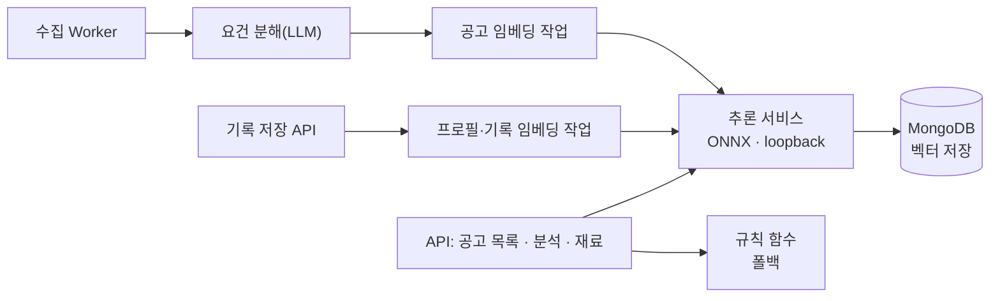

# 적합도 모델 본 학습 계획과 서빙 설계 v1

작성일 2026-10-25 · 대상: 채용 공고 추천 모델(모델 A) · 커리어 기록 추천 모델(모델 B)

이 문서는 2026-09-04 파일럿 학습의 결과를 정리하고, 본 학습에 들어가기 전에 해야
할 일, 학기 일정에 맞춘 진행 계획, 학습이 끝난 모델을 어디에 어떻게 배포해 서비스와
연결할지를 정한다. 파일럿 코드와 결과는 `origin/codex/p5-data-collection` 브랜치에
있고 main에는 머지되지 않았다.

## 1. 결정 사항

| 항목 | 결정 |
| --- | --- |
| 교사 모델 | Claude Sonnet 5.5 (`claude-sonnet-5-5`) 하나 |
| 호출 경로 | Claude API Message Batches, 구조화 출력(`output_config.format`)으로 JSON Schema 고정 |
| 학습 대상 | 모델 A: Bi-Encoder+MLP 선별 → Cross-Encoder 재정렬 · 모델 B: 요건–기록 쌍 채점 모델 |
| 공고 원천 | JTH 구조화 필드 → Expresso가 수집한 공고 원문과 분해 요건 |
| 데이터세트 버전 | `fit-v1` → `fit-v2` (설계서 3.3: 텍스트 구성이 바뀌면 버전을 올린다) |

### 교사 모델 조건

| 항목 | 값 |
| --- | --- |
| 모델 ID | `claude-sonnet-5-5` |
| 컨텍스트 | 1M 토큰, 최대 출력 128K |
| 가격 (100만 토큰당) | 입력 $2 · 출력 $10 · 캐시 읽기 $0.20 |
| Message Batches | 비동기 처리, 표준 가격의 50% |

출처: Claude API 스킬 모델 표(2026-10-06 캐시). 실행 전에 Models API로 다시 확인한다.

파일럿은 라벨 대부분(9,260건)을 GPT-5.6 Luna가 만들었고, Sonnet 라벨 740건은
Windows의 Claude Code CLI(`--model sonnet`)로 만들었다. 본 학습에서 API로 바꾸는
이유는 셋이다.

- CLI의 `sonnet`은 별칭이라 실행 시점에 어떤 모델이 판정했는지가 고정되지 않는다. API는 요청마다 모델 ID를 명시한다.
- CLI 경로는 구독 세션 한도(HTTP 429)에 걸리면 재설정까지 멈췄다. Batches는 요청 묶음을 한 번에 접수한다.
- 구조화 출력이 응답 형식을 스키마로 강제한다. 지금은 응답을 파싱한 뒤 감사 스크립트가 형식 오류를 걸러 낸다.

2026-10-21부터 Messages API는 `temperature` · `top_p` · `top_k`를 받지 않는다. 라벨의
재현은 샘플링 설정이 아니라 `llm-suitability-labeling-v1.md`가 정한 요청 해시
캐시(프롬프트 · 스키마 · 모델 · effort가 같은 완료 응답만 재사용)로 보장한다.

라벨 비용은 아직 계산하지 않는다. 앞서 잰 공고 토큰 수(중앙값 1,431)는 XLM-R
토크나이저 기준이라 Claude 토크나이저에 옮길 수 없다. 20쌍 표본을 `count_tokens`로
재고 나서 전체 비용을 정한다.

## 2. 파일럿 결과 요약

### 조건

- 합성 프로필 1,000개 × 공고 10개 = 10,000쌍. 분할은 프로필 840/90/70, 공고 2,366/292/228이고 분할 사이에 겹치는 ID는 0건이다.
- 후보 공고는 프로필마다 같은 직무 5개, 인접 직무 3개, 무작위 2개.
- 공고 입력은 JTH `jobs.csv`의 구조화 필드(직무 · 기술 · 경력 조건 등, 값은 영어)다.
- 라벨은 루브릭 `job-profile-fit-v1`. GPT-5.6 Luna 9,260건, Claude Sonnet 5 740건.
- 장비: RTX 5080 한 대, CUDA 12.8.

### 평가 분할 성능 (프로필 70명 × 공고 10개)

| 모델 | NDCG@10 | MAE | 공고쌍 순서 일치율 | Spearman |
| --- | ---: | ---: | ---: | ---: |
| BM25 | 0.8635 | 14.95 | 0.5827 | 0.2675 |
| Char TF-IDF | 0.8799 | 14.91 | 0.6334 | 0.3189 |
| 동결 E5 코사인 | 0.8370 | 15.29 | 0.5151 | 0.1605 |
| bge-reranker-v2-m3 (학습 없이) | 0.8535 | 15.41 | 0.5685 | 0.2315 |
| E5 Bi-Encoder+MLP | 0.9555 | 10.54 | 0.8025 | 0.6832 |
| bge Cross-Encoder (미세조정) | 0.9608 | 10.51 | 0.7903 | 0.6819 |

Char TF-IDF 대비 차이 (부트스트랩 20,000회, 평가 프로필 단위, 95% 신뢰구간):

| 비교 | NDCG@10 | MAE |
| --- | --- | --- |
| Bi-Encoder+MLP − Char TF-IDF | +0.0756 [0.0548, 0.0967] | −4.37 [−5.65, −3.02] |
| Cross-Encoder − Char TF-IDF | +0.0809 [0.0597, 0.1036] | −4.40 [−5.25, −3.53] |
| Cross-Encoder − Bi-Encoder+MLP | +0.0054 [−0.0046, 0.0160] | −0.03 [−0.94, 0.85] |

### 확인된 것

- 루브릭 교사 라벨을 작은 모델이 학습할 수 있다. 두 학습 모델 모두 단어 일치와 학습 전 임베딩 기준선보다 높다.

### 확인되지 않은 것

- **Cross-Encoder의 추가 이득:** Bi-Encoder+MLP와의 차이는 두 지표 모두 신뢰구간이 0을 포함한다.
- **서비스 조건의 성능:** 아래 3절의 일곱 가지 차이 때문에 위 수치를 서비스 성능으로 읽을 수 없다.
- **같은 직무 후보에서의 성능:** 구간별 MAE는 같은 직무에서 가장 크다. 서비스에서 사용자가 보는 공고는 대부분 같은 직무다.

  | 모델 | 같은 직무 | 인접 | 무작위 |
  | --- | ---: | ---: | ---: |
  | E5+MLP | 11.19 | 10.42 | 9.08 |
  | Cross-Encoder | 11.45 | 10.49 | 8.18 |

- **적합 공고 기준 지표:** 60점 이상 라벨은 410건(4.1%)이고, 평가 프로필 70명 중 13명만 적합 공고가 있다. MAP@10 · MRR@10은 13명 기준이다.
- **Recall@10 = 1.0:** 후보가 프로필당 10개라 구조상 나오는 값이다. 선별 단계의 Recall@K는 측정하지 않았다.
- **ROC · AUC, 지연:** 산출하지 않았다.
- **모델 B:** 학습도 평가도 하지 않았다.

## 3. 본 학습 전 선행 작업

파일럿과 서비스 사이의 차이 하나마다, 무엇을 만들면 그 차이가 없어지는지를 적는다.

### 3.1 공고 입력: 원문과 분해 요건

- **차이:** 파일럿 공고 입력은 JTH 구조화 필드를 `직무: …` 줄로 이은 텍스트다(`render_job()`). 서비스 공고는 `descriptionRaw` 원문이고, 로컬 DB 368건 중 한국어 위주가 212건, 영어 위주가 156건이다.
- **해야 할 일:** 수집하는 모든 공고에 요건 분해를 미리 돌린다.
  - 지금 `job_posting_requirements`는 로컬 368건 중 1건에만 있다. 사용자가 공고를 분석할 때만 만들어지기 때문이다.
  - 요건 추출기는 AI 계약 하나뿐이고 규칙 기반 폴백이 없다(`job-analysis/extractor.ts`). 미리 돌리면 공고당 LLM 호출이 1회 생긴다. 결과는 공고 단위로 저장되어 사용자끼리 공유된다.
- **산출물:**
  - 수집 Worker 뒤에 붙는 요건 분해 작업
  - 학습용 공고 스냅샷(원문 + 분해 요건 + `extractorVersion`)

### 3.2 입력 길이

- **차이:** 로컬 공고 원문은 XLM-R 토크나이저로 p10 / p50 / p90 / max = 708 / 1,431 / 2,098 / 4,086 토큰이다.
  - 512토큰(E5 한도)을 넘는 공고: 368건 중 352건
  - 1,536토큰(파일럿 Cross-Encoder 쌍 한도)을 공고만으로 넘는 공고: 157건
  - 파일럿에서도 Cross-Encoder 입력의 31.7%가 잘렸다.
- **해야 할 일:**
  - 인코더별 최대 길이를 비교 조건에 넣는다(아래 표).
  - 프로필을 하나로 이어 붙여 자르는 대신, 기록 단위로 인코딩하고 공고 요건과 기록을 대응시켜 모으는 방식을 비교한다.
  - Qwen3는 토크나이저가 다르므로 잘림 비율을 인코더마다 그 토크나이저로 다시 잰다.

| 인코더 (설계서 4.4 후보) | 파라미터 | `max_seq_length` | 벡터 차원 |
| --- | ---: | ---: | ---: |
| `intfloat/multilingual-e5-base` | 278.0M | 512 | 768 |
| `nlpai-lab/KURE-v1` | 567.8M | 8,192 | 1,024 |
| `BAAI/bge-m3` | 미기재 | 8,192 | 1,024 |
| `Qwen/Qwen3-Embedding-0.6B` | 595.8M | `sentence_bert_config.json` 없음. `max_position_embeddings` 32,768 | 1,024 |

출처: Hugging Face 모델 카드와 각 저장소의 `sentence_bert_config.json` · `config.json`(2026-10-25 조회). KURE-v1은 `BAAI/bge-m3`를 미세조정한 모델이다. bge-m3는 Hub 메타데이터에 파라미터 수가 없다.

### 3.3 프로필 분포

- **차이:**
  - 합성 프로필 스키마: 기록 1–20개, `bodyMd` 40–450자, 속성 최대 2개(`synthetic_profile_draft_v4.schema.json`).
  - 서비스 계약: `bodyMd`를 200,000자까지 허용한다.
  - 로컬 DB: 기록 본문 길이 중앙값이 0자이고, 기록이 있는 사용자 26명 중 20명이 기록 1개뿐이다.
- **해야 할 일:** 합성 프로필 v5에 기록 0–1개 프로필, 본문이 빈 기록, 450자를 넘는 긴 본문을 포함시킨다. 기록 수와 본문 길이의 목표 분포는 운영 DB의 집계를 보고 정한다. 이 문서 작성 시점에는 운영 DB를 조회하지 않았다.
- **산출물:** 합성 프로필 생성 스키마 v5와 분포 게이트

### 3.4 후보 공고 구성

- **차이:** 파일럿 후보 구성(같은 직무 5 · 인접 3 · 무작위 2)은 서비스에서 사용자가 공고를 보는 방식과 다르고, 60점 이상 쌍이 4.1%다.
- **해야 할 일:**
  - 같은 직무 비중을 늘린다.
  - 직접 근거가 풍부한 적합 쌍을 늘린다.
  - 직무명은 같지만 요건을 채우지 못하는 쌍(어려운 부적합 쌍)을 별도 구간으로 둔다.
- **산출물:** 후보 구성 규칙 v2와 구간별 목표 건수

### 3.5 사람 평가 세트

- **차이:** 파일럿은 교사 점수를 얼마나 재현하는지만 쟀다. 사람이 판정한 고정 세트가 없고, 교사 간 일치도도 없다. 두 교사는 프로필을 나눠 맡았고 같은 쌍을 두 번 판정하지 않았다.
- **해야 할 일:**
  - 서비스 형식(수집 공고 원문 + 합성 프로필) 쌍을 팀이 직접 루브릭으로 판정한다.
  - Sonnet 5.5의 판정과 일치도를 잰 뒤에 대량 라벨링을 시작한다.
  - 이 세트는 학습에 쓰지 않고 마지막 평가에만 쓴다.
- **산출물:** 사람 평가 세트, 판정 지침, 교사–사람 일치도 보고. 세트 크기와 일치도 기준은 1주차 첫날 정한다.

### 3.6 모델 B 정답

- **차이:** 교사 라벨에는 요구사항마다 근거 기록 ID(`evidenceRecordIds`)와 충족 수준이 들어 있고, 감사(`llm_suitability_audit.py`)도 거친다. 그런데 `llm_suitability_train.py`는 이 값을 읽지 않는다. 설계서는 모델 B를 "Cross-Encoder 재사용"으로 두었지만, 파일럿 Cross-Encoder는 (공고, 상위 기록 8개 묶음) 입력에 프로필 단위 점수를 학습했다. 모델 B가 받을 (요건, 기록 1건) 입력은 학습한 적이 없다.
- **해야 할 일:** 교사 응답 스키마에서 요건별 판정을 필수로 두고, (요건, 기록) 쌍과 충족 수준을 모델 B의 학습 정답과 평가 정답으로 쓴다.
- **산출물:** 모델 B 데이터세트(요건–기록 쌍)와 평가 지표(요건별 근거 기록 Recall@k, 기록 선택 NDCG)

### 3.7 학습 산출물과 재현

- **차이:** 파일럿 가중치(MLP 3.0 MiB, Cross-Encoder 196.23 MiB)와 데이터(`var/ml-data`)가 이 저장소의 체크아웃 어디에도 없고, `analysis.json`에 해시만 남아 있다. 합성 프로필 문서는 원자료 위치를 Windows 장비의 `C:\code\data`로 적었다.
- **해야 할 일:**
  - 학습 장비에서 데이터와 가중치 위치를 확인한다.
  - 설계서 4.4의 산출물(`metrics.json` · `metadata.json`)과 버전 규칙(`bi-{데이터세트}-{일련번호}` · `cross-{데이터세트}-{일련번호}`)을 학습 스크립트가 직접 쓰게 한다.
- **산출물:** 데이터 · 가중치 보관 위치와 버전 목록

### 3.8 데이터 이용 조건

| 데이터 | 이용 조건 | 본 학습에서 |
| --- | --- | --- |
| JTH | CC BY-NC 4.0, 비상업 연구만 허용 | 공고 원천을 수집 공고로 바꾸면 빠진다 |
| AI Hub 71592 | 학과 연구 프로젝트 안에서만 사용, 재배포 금지 | 합성 프로필의 경험 서술 원천으로 남는다 |
| YP2021 | 저장소 문서에서 이용 조건을 확인하지 못했다 | 합성 프로필의 경력 골격 원천으로 남는다 |
| 수집 공고 | 출처별 이용 조건이 따로 있다. 고용24는 공공데이터포털 조건이 변형 · 상업 이용을 제한한다 | 새 공고 원천 |

Expresso는 학과 프로젝트로만 운영하고 상용 서비스로 내지 않는다(2026-10-25 팀
결정). 위 데이터는 모두 연구 · 비상업 범위 안에서 쓰므로 본 학습에서 따로 다루지
않는다. 원본과 파생 원문을 재배포하지 않는다는 조건은 그대로 지킨다.

## 4. 진행 계획과 일정

학기 주차는 제안서 발표일 2026-09-04가 2주차인 것을 기준으로 계산했다.

| 주차 | 기간 | 설계서 일정 (그림 1.4) |
| --- | --- | --- |
| 9 | 10/26–11/1 | 인코더 비교 · 적합도 모델 학습 (7–10주) |
| 10 | 11/2–11/8 | 위와 같음 · 추천 연동 시작 (10–12주) |
| 11 | 11/9–11/15 | 추천 연동 · 성능 평가 · 통합 테스트 |
| 12 | 11/16–11/22 | 위와 같음 · 완료 보고서 시작 (12–13주) |
| 13 | 11/23–11/29 | 완료 보고서 · 시연 준비 |
| 14–15 | 11/30–12/13 | 최종 발표 · 심사 |

설계서는 학습을 7–10주에 잡았지만, 7–8주(10/12–10/25)에는 학습 작업이 없었다. 남은
학습 기간은 2주이므로 데이터 작업을 병렬로 돌리고, 학습과 연동을 겹쳐 진행한다.

| 주차 | 데이터 · 라벨 | 학습 · 평가 | 서빙 · 연동 |
| --- | --- | --- | --- |
| 9 | 요건 분해 미리 돌리기(3.1) · 합성 프로필 v5(3.3) · 후보 구성 v2(3.4) · 사람 평가 세트 판정(3.5) · `count_tokens` 표본 비용 산정 | 파일럿 데이터 · 가중치 위치 확인(3.7) · 학습 스크립트를 `fit-v2` 입력 형식에 맞춤 | 추론 서비스 골격과 계약(`packages/contracts`) |
| 10 | 교사–사람 일치도 확인 → Sonnet 5.5 Batches 대량 라벨링 → 감사 · `fit-v2` 고정 | 인코더 4종 비교(검증 분할) → 인코더 선정 → Bi-Encoder+MLP 학습 | 공고 임베딩 Worker · 프로필 임베딩 갱신 경로 |
| 11 | — | Cross-Encoder 학습 · 모델 B 학습 → 평가 분할 1회 평가 · ROC/AUC · Recall@K · 운영 서버 CPU 지연 측정 → Cross-Encoder 유지 여부 판정 | 백엔드 연결 · 규칙 폴백 · 통합 테스트 |
| 12 | — | 사람 평가 세트로 최종 비교 · 결과 리포트 | 운영 배포 · 설계서 9.2 반영 |

역할은 설계서 1.3을 따른다.

- 채서현: 학습 데이터 · 라벨 구축 · 추천 모델 학습 · 평가 · AI학습서버
- 윤규현: 데이터 · AI

작업별 담당 배정은 팀이 정한다.

## 5. 배포와 서비스 연결

### 5.1 실행 위치

운영 서버(`docs/operations/ORACLE_HOSTING.md`, 2026-08-13 실측):

| 항목 | 값 |
| --- | --- |
| CPU · 메모리 | 4 vCPU, 23GB 중 여유 8.7GB |
| 아키텍처 | aarch64 (Ampere), GPU 없음 |
| OS | Ubuntu 22.04.5 (glibc 2.35, 시스템 Python 3.10) |
| 공유 여부 | 다른 서비스 컨테이너와 함께 쓰는 공용 장비 |

- **실행 방식:** 학습은 학습 장비(RTX 5080)에서 하고, 서비스 추론은 운영 서버의 CPU에서 ONNX Runtime으로 돌린다.
- **Python 버전:** `onnxruntime` 1.31.0은 `manylinux_2_28_aarch64` 휠을 cp311 이상에만 배포한다(PyPI, 2026-10-25 조회). 시스템 Python 3.10으로는 설치할 수 없다.
- **권장 구성:** `python:3.12` arm64 컨테이너로 추론 서비스를 띄운다. `infra/compose.server.yaml`의 MongoDB · Redis처럼 loopback 포트에만 묶는다.

가중치만 올렸을 때의 메모리(fp32, 파라미터 × 4바이트로 계산한 값이며 측정값이 아니다):

| 모델 | 가중치 메모리 |
| --- | ---: |
| multilingual-e5-base | 1.11GB |
| KURE-v1 · bge-reranker-v2-m3 | 2.27GB |
| Qwen3-Embedding-0.6B | 2.38GB |

INT8 양자화 ONNX가 메모리와 지연을 줄이는 경로다. CPU 지연은 측정하지 않았다.
Cross-Encoder는 상위 K건마다 공고와 기록을 함께 읽으므로 CPU에서 가장 느릴
가능성이 큰 단계다. **Cross-Encoder는 운영 서버에서 잰 p95 지연이 기준을 넘지 않을
때만 유지한다.** 넘으면 Bi-Encoder+MLP 점수로 순위를 정한다. 파일럿에서 두 모델의
품질 차이가 구분되지 않았으므로 이 판정이 품질 근거를 잃지는 않는다.

### 5.2 연결 구조

- **계약:** 추론 서비스의 요청 · 응답 스키마는 `packages/contracts`에 Zod로 둔다. 백엔드는 응답을 파싱하고, 계약을 어기면 그 자리에서 실패시킨다.
- **엔드포인트:**

  | 엔드포인트 | 호출하는 곳 |
  | --- | --- |
  | 공고 임베딩(배치) | 수집 Worker |
  | 프로필 · 기록 임베딩 | 기록 저장 후 Worker |
  | 선별 점수 · 상위 K | 공고 목록 |
  | 재정렬 | 공고 목록 |
  | 요건–기록 채점 (모델 B) | 공고 분석 · 재료 고르기 |

- **벡터 저장:** 공고 벡터는 `job_postings`에 둔다. 768차원 float32는 공고당 3,072바이트, 1,024차원은 4,096바이트다. 현재 공고 규모에서는 전체 코사인 계산으로 충분하다. 자체 호스팅 MongoDB의 벡터 검색 기능은 확인하지 않았으므로 이 계획에 넣지 않는다.
- **규칙 폴백:** 추론 서비스가 응답하지 않거나 `MATCH_MODEL=off`(기본값)이면 지금의 규칙 함수가 그대로 동작한다. CI와 테스트는 기본값으로 돌아 영향을 받지 않는다. `AI_PROVIDER` 기본값 `off`와 같은 방식이다.

### 5.3 백엔드 연결 지점

| 지점 | 지금 | 바꿀 것 |
| --- | --- | --- |
| `services/backend/src/modules/jobs/service.ts:144` | `calculateExplainableMatch()` 문자열 포함 비율 | 모델 A 점수. 요건별 근거 표시는 모델 B 결과로 채운다 |
| `services/backend/src/modules/job-analysis/service.ts:96` | 같은 함수 | 모델 A 점수 |
| `services/backend/src/modules/job-analysis/service.ts` 요건별 커버리지(`requirementCoverages`) | `calculateRequirementCoverage()` 규칙 | 모델 B 요건–기록 채점 |
| `services/backend/src/modules/materials/service.ts:19` | `rankMaterials()` 토큰 중첩 | 모델 B 기록 점수와 선택 조합 |
| Worker | 해당 작업 없음 | 요건 분해 · 공고 임베딩 · 프로필 임베딩 작업 유형 추가 |

### 5.4 결정 필요

- **가중치 배포 경로:** Git LFS, 비공개 Hugging Face 저장소, 오브젝트 스토리지 중 무엇으로 학습 장비에서 운영 서버로 옮길지.
- **Cross-Encoder 유지 기준:** 5.1의 p95 지연 기준값.

## 6. 설계서에 반영할 변경

이 계획이 확정되면 설계서를 별도 작업으로 고친다.

- 3장 교사: GPT-5.6 Luna · Claude Sonnet → Claude Sonnet 5.5
- 3장 공고 원천: JTH 구조화 필드 → 수집 공고 원문과 분해 요건
- 3.3 데이터세트: `fit-v1` → `fit-v2`, 프로필 분포와 후보 구성 갱신
- 4장 모델 B: "Cross-Encoder 재사용" → 요건–기록 쌍으로 학습한 모델
- 4.4 Cross-Encoder: 운영 서버 지연 측정 결과에 따라 유지 여부를 정한다는 조건 추가
- 9.2 평가: 사람 평가 세트 추가, ROC/AUC · Recall@K 실제 산출값 반영
