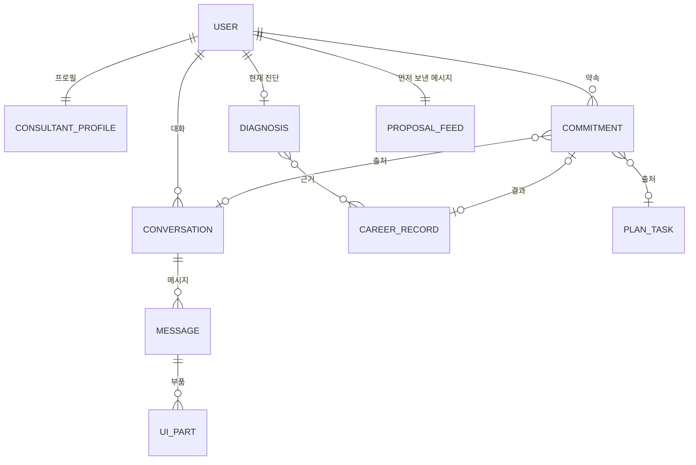

# Expresso AI 기획서

기획 보드: https://claude.ai/artifact/Btwx2jrzpawNdFeMFMTvye

Expresso AI를 커리어 컨설턴트 에이전트로 만드는 기획이다.

## 문제 정의

구직 목표에서 포트폴리오까지 가는 과정은 아래 순서로 진행된다.

1. 목표에 비해 부족한 점을 안다.
2. 부족한 점을 채우는 행동을 한다.
3. 한 행동을 커리어 기록으로 남긴다.
4. 기록으로 포트폴리오를 만든다.

지금 익스프레소는 단계마다 기능을 제공하지만, 한 단계에서 다음 단계로 넘어가는 일은 사용자의 의지에만 맡긴다. Expresso AI는 이 과정을 이어 주고 사용자의 행동을 유도해야 한다.

### 구현 현황 (2026-11-20)

| 확인한 것 | 근거 |
| --- | --- |
| 대화 도구는 기록 읽기, 기록 초안, 요건 대조, 보완점 정리, 준비 계획, 구직 목표 변경, 포트폴리오 요소 고치기다. 공고나 활동을 찾는 도구와 포트폴리오를 만드는 도구는 없다. | `services/backend/src/platform/agent/runtime.ts`의 `TOOL_NAMES` |
| 대화에 붙일 수 있는 자료는 공고, 기록, 포트폴리오다. 활동 데이터와 방문 분석은 대화에서 읽지 못한다. | `packages/contracts/src/agent-chat.ts`의 `AgentContextSchema` |
| 준비 계획의 작업을 완료하면 결과 글과 링크가 계획에만 저장된다. 커리어 기록으로 넘어가는 경로가 없다. | `services/backend/src/modules/agent-chat/plans.ts`의 `updateTask` |
| 확인 시점에는 개발 멤버와 관리자가 연 더미 계정만 서버 인증으로 대화했다. 같은 날 PR #248이 모든 계정에 열었다. | `.intent/intent_agent-chat-open.md` |

## 제품 정의

Expresso AI는 목표에 비해 부족한 점을 짚고, 행동을 유도하고, 대화로 기록을 만들고, 기록을 포트폴리오로 잇는 커리어 컨설턴트다.

### 대상 사용자

이직과 취업을 준비하는 구직자다. 탐색, 준비, 지원 단계를 모두 다룬다. 컨설턴트는 사용자가 어느 단계에 있는지 알아보고 그 단계에 맞는 일을 한다.

| 단계 | 사용자의 상태 | 컨설턴트가 주로 하는 일 |
| --- | --- | --- |
| 탐색 | 하고 싶은 일이 아직 정해지지 않음 | 목표를 함께 정한다 |
| 준비 | 목표는 있고 경험과 역량을 쌓는 중 | 부족한 점을 짚고 행동을 유도하고 기록으로 남긴다 |
| 지원 | 지원할 공고를 고르고 포트폴리오를 만드는 중 | 공고에 맞춰 기록을 고르고 포트폴리오를 만든다 |

### 핵심 가치

다음에 할 일이 늘 정해져 있고, 대화만 하면 기록이 쌓인다.

### 설계 원칙

1. **목표가 기준이다.** 모든 판단과 제안은 구직 목표에서 출발한다.
2. **먼저 다가가고 끝까지 챙긴다.** 사용자가 묻기 전에 다음 행동을 내놓고, 제안한 행동을 했는지 확인해 이어 간다.
3. **사용자는 대화만 한다.** 기록에 넣을 내용은 에이전트가 인터뷰 질문으로 끌어내고, 문서로 정리하는 일은 자동으로 한다.
4. **기록과 포트폴리오로 끝낸다.** 행동은 기록이 되고, 기록은 포트폴리오에 들어갈 때까지 챙긴다.
5. **대화 화면이 UI를 제공한다.** 컨설턴트는 보여 줄 것은 시각 요소로, 물어볼 것은 조작할 수 있는 요소로 낸다.

### 접근과 과금

- 모든 요금제의 사용자가 서버 인증으로 대화한다. PR #248(2026-11-20 병합)이 구현했다. 개인 Anthropic API 키는 선택 사항으로 남아 있고, 등록한 사용자는 자기 키로 대화한다.
- 사용량은 요금제의 월 크레딧에서 차감한다. 요금제는 Single Shot(무료, 월 100크레딧), Double Shot(9,900원, 월 1,000크레딧), Extra Shot(19,900원, 월 2,500크레딧)이고 1크레딧은 10,000토큰이다. 이번 달 크레딧을 다 쓰면 대화를 보낼 수 없다.
- 컨설턴트가 먼저 연락하는 기능은 온보딩에서 동의를 받고 기본으로 켠다. 설정에서 끌 수 있다.

### 첫 버전 완료 기준

운영 환경에서 사용자 한 명이 아래 과정을 처음부터 끝까지 거친다. 그동안 다음에 할 일을 사용자가 스스로 찾아야 하는 지점이 없다.

1. 컨설턴트와 대화해 구직 목표를 정한다.
2. 컨설턴트가 목표에 비해 부족한 점을 짚고 할 행동을 제안한다.
3. 사용자가 행동하면 컨설턴트가 먼저 진행을 묻는다.
4. 대화만으로 그 행동이 커리어 기록으로 저장된다.
5. 컨설턴트가 그 기록으로 포트폴리오를 만들자고 제안하고, 포트폴리오가 만들어진다.

## 사용 흐름

사용자가 스스로 하는 일은 4번뿐이다. 나머지는 컨설턴트가 시작한다.

1. **목표 정하기**: 대화로 구직 목표를 정한다.
2. **부족한 점 짚기**: 컨설턴트가 목표와 기록을 비교한다.
3. **행동 제안**: 컨설턴트가 활동, 공고, 준비 계획을 제안한다.
4. **행동**: 사용자가 제안받은 일을 한다.
5. **진행 확인과 인터뷰**: 컨설턴트가 진행을 묻고, 대화 내용이 기록으로 저장된다. 저장된 기록을 기준으로 2번으로 돌아간다.
6. **포트폴리오 제안**: 기록이 쌓이면 컨설턴트가 포트폴리오를 만들자고 제안하고, 만들어 배포한다.

### 연락 시점

| 시점 | 뜻 |
| --- | --- |
| 약속한 날 | 준비 계획의 작업 마감일, 사용자가 대화에서 하겠다고 말한 날 |
| 새 소식 | 목표에 맞는 공고나 활동이 들어온 날 |
| 대화가 없을 때 | 일정 기간 대화가 없을 때 |

### 연락 경로

홈 화면의 제안 카드와 앱 안 알림을 쓴다. 이메일은 보류한다.

## 범위와 제약

### 플랫폼과 저장

- 데스크톱 브라우저의 웹에서 쓴다.
- 저장은 지금의 MongoDB와 Redis, BullMQ Worker를 쓴다.
- 외부 서비스는 지금 쓰는 것만 쓴다. 이메일 연락은 보류한다.

### 첫 버전의 기능 묶음

아래 묶음이 모두 들어간다. 하나라도 빠지면 완료 기준의 과정이 중간에 끊긴다. 묶음마다 완료 기준에 필요한 동작만 넣는다.

| 묶음 | 하는 일 | 지금 있는 것 | 없는 것 |
| --- | --- | --- | --- |
| 진단 | 목표를 기준으로 부족한 점을 짚는다 | 대화에 붙인 공고 하나와 기록을 대조해 보완점을 정리한다 | 공고를 붙이지 않고 목표만으로 부족한 점을 짚는 일 |
| 행동 제안 | 공고와 활동을 찾아 권하고 준비 계획을 세운다 | 홈 제안 카드(공고, 공모전, 기록), 공고에 묶인 준비 계획 | 대화에서 공고와 활동을 찾는 도구, 목표 기준의 준비 계획 |
| 챙기기 | 약속을 기억하고 진행을 묻고 알림을 보낸다 | 없음 | 전부 |
| 대화로 기록 | 인터뷰로 끌어내 기록으로 자동 저장한다 | 대화에서 기록 초안을 만들고 사용자가 카드에서 승인한다 | 인터뷰를 이끄는 동작, 자동 저장, 준비 계획의 결과를 기록으로 넘기는 일 |
| 포트폴리오 잇기 | 대화에서 포트폴리오 제작을 시작한다 | 대화에서 포트폴리오 요소 고치기 | 대화에서 제작을 시작하는 도구 |
| 컨설턴트의 기억 | 사용자의 단계, 약속, 진행 상태를 대화가 바뀌어도 이어 간다 | 구직 목표 | 나머지 전부. 지금은 대화마다 따로 시작한다 |
| 대화 속 화면 | 컨설턴트가 상황에 맞는 UI를 골라 대화에 넣고, 사용자가 조작한 결과를 돌려받는다 | 도구마다 고정된 카드(요건 대조, 보완점, 기록 초안, 준비 계획, 구직 목표 변경, 지면 고치기) | 에이전트가 고르는 범용 부품, 조작 결과를 돌려받는 경로, 시각 자료 생성 |

### 미머지 PR

- `agentic-chat` PR(#152, #154, #180, #229)은 묶음을 구현할 때 필요한 부분의 코드와 테스트만 `main` 위에 옮겨 쓴다. 옮길 후보는 공고 검색 도구, 기록 근거 검색, 실행 예산, 한국어 평가 사례다.
- 이 PR들은 차례로 쌓여 있고 #229가 앞의 PR을 포함한다. #229는 2026-11-20 기준 `main`과 16개 파일에서 충돌한다.
- 제작 흐름을 대화로 옮기는 작업은 `feat/brew-chat`과 디자인 대화 PR #241이 맡는다. 「포트폴리오 잇기」는 그 작업이 만든 제작 시작 도구를 쓴다.

### 비용

- 컨설턴트가 시작하는 실행도 사용자의 월 크레딧에서 차감한다.
- 실측값: 도구를 한 번 쓰는 짧은 대화는 약 3크레딧(`.intent/intent_agent-chat-open.md`), 능동 제안 한 번은 약 0.6크레딧(`.sitrep/sessions/20261115-1330-agent-home/trajectory.md`)이다.

## 정보 구조

### 대화 형태

대화는 주제별로 여러 개다. 사이드바의 최근 대화에서 고른다. 컨설턴트는 어느 대화에서든 목표, 단계, 약속, 지난 대화의 요지를 안다. 컨설턴트가 먼저 보낸 메시지는 홈 카드와 알림으로 오고, 누르면 그 주제의 새 대화가 열린다.

### 화면 구성

사이드바의 홈, 라이브러리, 탐색, 분석과 최근 대화는 그대로 둔다. 아래 자리만 바꾼다.

| 자리 | 지금 | 바뀌는 것 |
| --- | --- | --- |
| 홈의 제안 카드 | 공고, 공모전, 기록 제안 | 컨설턴트가 먼저 보낸 메시지가 모두 온다. 약속 확인, 새 소식, 부족한 점 제안이 같은 카드 틀을 쓴다. |
| 대화 화면 | 도구마다 고정된 카드, 초안은 승인해야 저장 | 컨설턴트가 고른 UI가 메시지 사이에 들어간다. 저장된 기록은 「저장됨」 카드로 보인다. |
| 알림 | 마감, 저장한 검색, 생성, 방문 | 컨설턴트 알림 종류를 더한다. 누르면 해당 대화로 간다. |
| 구직 목표 화면(`/goal`) | 구직 목표 | 「내 진행」으로 넓힌다. 목표, 지금 단계, 부족한 점, 약속, 최근 저장된 기록을 보고 고친다. |
| 온보딩 | 구직 목표 질문 | 먼저 연락하기 동의를 더한다. |

### 대화 속 화면

UI가 하는 일은 아래와 같다.

| 하는 일 | 예 | 만드는 방식 |
| --- | --- | --- |
| 묻기 | 선택지, 여러 개 고르기, 날짜와 기간, 척도, 짧은 입력 폼 | 부품 조합 |
| 결과물 다루기 | 저장된 기록, 준비 계획, 포트폴리오 미리보기와 제작 시작 | 부품 조합 |
| 보여 주기 | 비교 표, 진행 상태, 일정, 목표 대비 부족한 점, 공고와 활동 목록 | 부품 조합. 부품에 없는 시각 자료는 컨설턴트가 생성한다 |

- 부품은 디자인 토큰(`services/web/src/styles/tokens.css`)을 따른다.
- 사용자가 조작하는 UI는 부품으로만 만든다. 조작 결과를 정해진 형식으로 돌려받기 위해서다.

## 기능 범위

묶음마다 첫 버전에 넣는 동작이다.

### 컨설턴트의 기억

컨설턴트는 대화가 바뀌어도 아래 내용을 이어 간다. 사용자는 「내 진행」 화면에서 보고 고친다.

| 기억하는 것 | 뜻 |
| --- | --- |
| 구직 목표 | 하고 싶은 일, 일하고 싶은 곳, 시기와 지금 상황 |
| 단계 | 탐색, 준비, 지원 중 어디인지 |
| 진단 결과 | 목표가 요구하는 것과 항목별 상태 |
| 약속 | 무엇을 언제까지 하기로 했는지 |
| 지난 대화의 요지 | 대화가 끝나면 컨설턴트가 요약해 둔다 |
| 선호와 거절 | 「관심 없음」으로 넘긴 공고와 활동, 싫다고 말한 조건. 제안에서 뺀다 |

### 진단

1. 구직 목표에 맞는 실제 공고를 모으고, 그 공고들의 요건이 얼마나 자주 나오는지 세어 「이 목표가 요구하는 것」의 목록을 만든다. 사용자가 관심 표시한 공고에 무게를 더 둔다. 지금 있는 수요 집계(`POST /v1/jobs/demand-summary`)는 공고의 기술 키워드 빈도를 세고, 공고가 다섯 건 이상일 때 값을 낸다. 경험과 자격 요건의 집계는 새로 만든다.
2. 목록을 사용자의 기록과 대조해 확인됨, 일부 확인됨, 확인 안 됨으로 나눈다. 지금 있는 요건 대조를 쓴다.
3. 확인 안 된 항목은 먼저 해 본 적이 있는지 묻는다. 해 봤으면 인터뷰로 넘어가 기록이 되고, 안 해 봤으면 부족한 점이 된다.
4. 부족한 점을 대화 속 화면으로 보여 주고, 먼저 채울 것을 정한다. 근거는 「목표와 맞는 공고 40건 중 28건이 요구한다」처럼 표본과 함께 댄다.
5. 목표에 맞는 공고가 적으면 표본이 적다고 밝히고 컨설턴트의 판단으로 보완한다.
6. 기록이 저장되거나 목표가 바뀌면 다시 진단한다.

### 행동 제안

1. 부족한 점마다 맞는 행동을 고른다. 이미 한 일이면 인터뷰, 경험이 필요하면 활동(공모전, 해커톤, 인턴)이나 프로젝트, 지식이 필요하면 학습, 준비가 됐으면 공고 지원이다.
2. 컨설턴트가 대화에서 공고와 활동을 직접 찾는다. 공고 검색 도구는 `agentic-chat` PR에서 옮겨 온다.
3. 다음에 할 일을 하나로 정해 제안한다. 사용자가 받아들이면 약속이 된다.
4. 공고의 적합 여부는 추천 모델이 거른 뒤 컨설턴트가 판단한다. 추천 모델이 제품에 연결되기 전까지는 지금 있는 공고 검색과 적합도 계산으로 거른다.

### 챙기기

1. 사용자가 제안을 받아들이거나 「다음 주까지 하겠다」고 말하면 약속으로 저장한다. 대화에 약속 카드가 뜨고, 카드에서 날짜를 고친다.
2. 약속한 날에 홈 카드와 알림으로 묻는다. 사용자는 선택지로 답한다.
   - 「했어요」: 인터뷰로 넘어가 기록이 된다.
   - 「아직이에요」: 막힌 이유를 묻고 날짜를 다시 잡거나 계획을 고친다.
   - 「안 하기로 했어요」: 약속을 닫고 다른 행동을 제안한다.
3. 목표에 맞는 새 공고나 활동이 들어오면 알린다. 지금 있는 능동 제안을 넓힌다.
4. 일정 기간 대화가 없으면 메시지를 한 번 보낸다.

챙기는 강도는 아래와 같다.

| 항목 | 값 |
| --- | --- |
| 약속 확인 | 약속한 날에 한 번. 답이 없으면 3일 뒤에 한 번 더 보내고 멈춘다 |
| 대화가 없을 때 보내는 메시지 | 2주에 한 번 |
| 알림 | 하루에 한 건까지 |
| 크레딧이 떨어졌을 때 | 약속 확인은 AI 없이 정해진 문구로 계속 보낸다. 답을 받아 이어 가는 대화는 다음 달에 한다 |

### 대화로 기록

1. 사용자가 한 일을 말했을 때, 준비 계획의 작업을 마쳤다고 했을 때, 컨설턴트가 진행을 물었을 때 인터뷰를 시작한다.
2. 상황, 역할, 행동, 결과 중 빠진 것을 한 번에 하나씩 묻는다. 고를 수 있는 질문은 선택지 부품으로 낸다.
3. 내용이 모이면 컨설턴트가 문서로 정리해 저장하고, 대화에 「저장됨」 카드를 낸다. 카드에서 기록을 열거나 저장을 되돌린다.
4. 이미 있는 기록에 대한 이야기면 그 기록에 내용을 더한다.
5. 사용자가 말한 내용만 쓴다. 문장마다 근거가 된 사용자의 말을 연결해 둔다. 지금 있는 출처 검증(`services/backend/src/modules/agent-chat/record-draft.ts`)을 그대로 쓴다.
6. 자동 저장된 기록의 상태는 「정리됨」(`organized`)이다. 사용자가 기록을 열어 확인하면 「확인됨」(`verified`)이 된다. 제작의 재료 고르기는 두 상태의 기록을 모두 쓰고 「확인됨」에 점수를 더 준다(`services/backend/src/modules/materials/ranking.ts`). 포트폴리오를 만들 때 컨설턴트가 「정리됨」 상태의 기록을 알린다.

### 포트폴리오 잇기

1. 컨설턴트는 아래 시점에 포트폴리오를 제안한다.
   - 지원할 때: 목표에 맞는 공고가 있고, 그 공고의 요건을 채우는 기록이 충분할 때
   - 기록이 쌓였을 때: 포트폴리오가 아직 없고 기록이 어느 정도 모였을 때
   - 고칠 때: 포트폴리오를 만든 뒤 새 기록이 저장됐을 때
2. 컨설턴트가 쓸 기록을 고르고 이유를 붙여 대화 속 화면으로 보여 준다. 사용자는 기록을 빼거나 더한다.
3. 제작은 대화 안에서 끝까지 한다. 제작 단계를 대화로 옮기는 일은 다른 작업(`feat/brew-chat`, 의도 문서 `.intent/intent_brew-chat-start.md`)이 맡는다. 이 기획은 제안하는 시점, 재료 준비, 그 작업이 만든 제작 시작 도구를 부르는 데까지 맡는다.
4. 생성이 끝나면 컨설턴트가 알리고 배포까지 안내한다.

### 대화 속 화면

부품은 범용 부품과 도메인 카드로 나눈다.

- **범용 부품**: 컨설턴트가 채운 내용을 받아 그리는 부품이다.
- **도메인 카드**: 도구의 결과에 묶인 카드다. 지금 있는 카드(요건 대조, 보완점, 준비 계획, 구직 목표 변경, 지면 고치기)와 제작 흐름의 카드가 여기에 든다.

첫 버전의 부품은 아래와 같다.

| 하는 일 | 부품 | 쓰는 곳 |
| --- | --- | --- |
| 묻기 | 선택지(하나, 여럿) | 약속 확인의 답, 인터뷰 질문, 먼저 채울 것 고르기 |
| 묻기 | 짧은 입력 | 인터뷰에서 수치와 기간 받기 |
| 묻기 | 날짜 | 약속 날짜 정하기와 미루기 |
| 보여 주기 | 목록 | 찾은 공고와 활동, 고른 기록 |
| 보여 주기 | 비교 표 | 공고와 활동 견주기 |
| 보여 주기 | 진행 상태 | 진단 결과(요구 항목별 상태) |
| 결과물 다루기 | 저장된 기록 | 자동 저장 뒤 열기와 되돌리기 |
| 결과물 다루기 | 약속 | 약속 저장 뒤 날짜 고치기 |
| 결과물 다루기 | 재료 고르기 | 포트폴리오에 쓸 기록 빼고 더하기 |
| 보여 주기(생성) | 그림 | 부품에 없는 설명 그림 |

- 사용자가 부품을 조작하면 그 결과가 사용자의 말로 대화에 남는다. 컨설턴트는 그 말을 읽고 이어 간다.
- 알림과 대화 목록의 미리보기에서는 부품의 내용을 글로 보여 준다.

## 데이터 모델

새로 두는 엔티티와 고치는 엔티티다. 칸의 목록은 마일스톤마다 쓰는 명세에서 정한다.

| 엔티티 | 담는 것 | 소유 모듈 | 바꾸는 방식 |
| --- | --- | --- | --- |
| 컨설턴트 프로필 | 사용자의 단계, 선호와 거절, 연락 설정(동의, 마지막으로 연락한 날) | `consultant` | 새로 둔다 |
| 진단 | 진단할 때의 구직 목표, 표본이 된 공고의 수, 요구 항목(빈도, 상태, 근거 기록) | `consultant` | 새로 둔다 |
| 약속 | 할 일, 날짜, 상태(열림, 완료, 미룸, 닫음), 출처, 확인 이력, 결과로 저장된 기록 | `consultant` | 새로 둔다 |
| 대화 요지 | 대화가 끝난 뒤의 요약 | `agent-chat` | 대화에 칸을 더한다 |
| UI 부품 | 부품의 종류와 내용 | `agent-chat`, 계약은 `packages/contracts` | 도구 결과에 칸을 더한다 |
| 부품의 답 | 사용자가 부품을 조작한 결과 | `agent-chat` | 사용자 메시지에 칸을 더한다 |
| 컨설턴트가 먼저 보낸 메시지 | 약속 확인, 새 소식, 대화가 없을 때 보내는 메시지 | `proposals` | 제안 피드에 종류를 더한다 |
| 알림 | 컨설턴트 알림 | `engagement` | 알림 종류를 더한다 |
| 동의 | 먼저 연락하기 동의 | `consent` | 동의 목적을 더한다 |
| 커리어 기록 | 인터뷰로 만든 기록과 문장별 근거 | `career` | 지금 엔티티를 쓴다 |

- 약속의 출처는 대화의 메시지이거나 준비 계획의 작업이다. 준비 계획은 지금 `agent-chat` 모듈의 저장소(`preparation_plans`)에 있고, 약속은 작업을 참조한다.
- 지금 도구 결과(`AgentToolResultSchema`)는 카드마다 칸을 갖는다. `feat/brew-chat`도 같은 방식으로 제작 시작 카드의 칸을 더했다. 범용 부품은 이 자리에 칸 하나로 들어간다.
- 지금 면접 모듈이 만드는 기록은 `origin`이 `interview`이고 상태가 「정리됨」이다(`services/backend/src/modules/interview/service.ts`). 대화로 만든 기록도 같은 방식으로 구분한다.
- 스키마와 마이그레이션은 `packages/database`가 소유한다.

## 기술 구조

### 실행

- 대화 실행은 지금 구조를 쓴다. API 프로세스에서 Claude Agent SDK의 `query`가 실행되고, 도구는 프로세스 안의 MCP 서버(`expresso`)에 등록한다(`services/backend/src/platform/agent/runtime.ts`).
- 컨설턴트의 기억은 실행을 시작할 때 서버가 읽어 프롬프트에 자료로 싣는다. 지금 구직 목표(`jobGoal`)를 싣는 방식과 같다.
- 묶음마다 도구를 더한다: 기억 고치기, 진단 실행과 읽기, 공고와 활동 검색, 약속 만들기와 고치기, 기록 저장, 재료 제안, 부품 내기, 그림 내기. 도구의 이름과 입력은 마일스톤의 명세에서 정한다.

### 대화 속 화면

1. 부품의 스키마는 `packages/contracts`에 둔다.
2. 컨설턴트는 부품을 내는 도구에 부품의 종류와 내용을 넣어 부른다.
3. 서버가 입력을 계약으로 검증한다. 어긋난 칸이 있으면 그 칸만 고쳐 다시 받는다. 지금 도구들이 쓰는 방식(`AgentToolRejection`)이다.
4. 웹은 부품의 종류를 컴포넌트에 연결한 등록표로 그린다. 도메인 카드도 같은 등록표에 등록한다.
5. 사용자가 부품을 조작하면 메시지 보내기 API가 답을 받아 사용자 메시지로 저장하고 다음 실행을 시작한다.

그림은 컨설턴트가 SVG로 쓴다. 서버가 스크립트와 외부 참조를 제거하고, 웹은 이미지로 그린다.

### 컨설턴트가 먼저 보내는 메시지

- 예약 작업이 매일 약속의 날짜와 마지막 대화 시각을 읽어 제안 피드에 카드를 넣고 알림을 만든다. 예약 작업의 키는 코드의 목록(`SCHEDULED_JOB_KEYS`)과 DB의 검증 규칙에 함께 넣는다.
- 약속 확인과 대화가 없을 때 보내는 메시지는 정해진 문구와 선택지로 만든다. 크레딧 소비는 0이다.
- 새 소식 제안은 지금의 능동 제안을 쓴다. AI 계약 호출 한 번이고 가장 낮은 단계의 모델을 쓴다.
- 사용자가 카드의 선택지를 누르면 서버가 컨설턴트의 메시지와 사용자의 답을 대화에 넣는다. 모델 실행은 그다음 차례부터 시작한다.
- 알림은 하루에 한 건까지 만든다. 지금 `notify()`의 중복 방지는 하루 단위다.

### 진단

- 구직 목표의 글을 검색 조건으로 바꾸는 일은 지금의 자연어 검색 해석(`POST /v1/jobs/search/interpret`)을 쓴다. AI 호출이므로 결과를 진단에 저장해 다시 쓴다.
- 공고를 모으고 요건의 빈도를 세는 일은 `jobs` 모듈의 서버 로직이 한다.
- 기록과의 대조와 확인 질문은 대화 실행이 한다.

### 대화 요지

대화가 끝난 뒤 Worker가 AI 계약 호출 한 번으로 요약한다. 가장 낮은 단계의 모델을 쓴다.

### 모듈

| 모듈 | 맡는 것 |
| --- | --- |
| `consultant` (새 모듈) | 컨설턴트 프로필, 진단, 약속 |
| `agent-chat` | 대화, 대화 요지, 부품과 답의 저장, 도구가 부르는 진입점 |
| `platform/agent` | 실행과 도구 등록 |
| `proposals` | 컨설턴트가 먼저 보낸 메시지의 저장과 표시 |
| `scheduling` | 약속 확인과 대화 요지의 예약 실행 |
| `engagement` | 알림 |
| `jobs` | 공고 검색, 요건 집계 |
| `career` | 기록 저장과 상태 |

모듈은 다른 모듈의 진입점과 `packages/contracts`만 쓴다.

### 크레딧 추정

실행 한 번은 약 3크레딧이다(실측, `.intent/intent_agent-chat-open.md`). 아래 실행 수는 추정이고, 첫 마일스톤에서 실측한다.

| 구간 | 실행 수(추정) | 크레딧(추정) |
| --- | --- | --- |
| 목표 정하기 | 3 | 9 |
| 진단과 확인 질문 | 4 | 12 |
| 행동 제안 | 2 | 6 |
| 약속 확인의 답 | 1 | 3 |
| 인터뷰와 기록 저장 | 5 | 15 |
| 포트폴리오 제안과 재료 준비 | 2 | 6 |
| 합계 | 17 | 51 |

- 포트폴리오 생성의 크레딧은 이 표에 없다. 측정한 값이 없다.
- 능동 제안은 한 번에 약 0.6크레딧이다. 매일 실행하면 한 달에 약 18크레딧이다.
- 표와 능동 제안을 더하면 약 69크레딧이다. 무료 요금제의 월 100크레딧에서 포트폴리오 생성에 쓸 수 있는 양은 약 31크레딧이다.

크레딧 소비는 아래 방법으로 줄인다.

- 약속 확인과 대화가 없을 때 보내는 메시지는 정해진 문구와 선택지로 만든다.
- 날짜 미루기와 약속 닫기처럼 서버가 처리할 수 있는 답은 모델 실행 없이 처리한다.
- 능동 제안은 새 공고나 활동이 들어온 날에만 실행한다. 지금은 매일 실행한다.

무료 요금제의 월 크레딧은 올린다. 값은 첫 마일스톤에서 실행 한 번의 크레딧을 실측한 뒤에 정한다.

### 실행 예산과 평가

- 지금 실행의 한도는 `maxTurns: 8`과 `maxBudgetUsd: 1`이다. 도구 호출 수와 모델 호출 수의 한도는 `agentic-chat` PR의 실행 예산을 옮겨 와 더한다.
- `agentic-chat` PR의 한국어 평가 사례를 옮겨 오고, 완료 기준의 과정을 평가 사례로 더한다.

## 개발 일정

마일스톤마다 브랜치와 PR을 따로 두고, 의도 · 명세 · 계획 문서를 쓴 뒤 구현한다. 날짜는 정해지지 않았다.

| 순서 | 마일스톤 | 넣는 것 | 완료 조건 | 완료 기준의 단계 |
| --- | --- | --- | --- | --- |
| 1 | 부품의 토대 | 부품 계약, 부품을 내는 도구, 선택지 부품, 답을 받는 경로, 등록표 | 대화에서 컨설턴트가 선택지를 내고, 고른 답으로 대화가 이어진다. 실행 한 번의 크레딧을 실측한다 | 전체 |
| 2 | 컨설턴트의 기억 | 컨설턴트 프로필, 대화 요지, 프롬프트에 싣기, 「내 진행」 화면 | 새 대화에서 컨설턴트가 지난 대화의 요지와 단계를 근거로 답한다 | 1 |
| 3 | 대화로 기록 | 인터뷰, 자동 저장, 저장된 기록 카드, 짧은 입력 부품 | 대화만으로 기록이 「정리됨」으로 저장되고 카드에서 되돌린다 | 4 |
| 4 | 챙기기 | 약속, 약속 카드와 날짜 부품, 예약 작업, 알림 종류, 홈 카드, 동의 | 약속한 날 알림이 오고, 선택지로 답하면 인터뷰가 시작된다 | 3 |
| 5 | 진단 | 요건 집계, 기록과의 대조, 진행 상태 부품, 확인 질문 | 공고를 붙이지 않은 대화에서 목표 기준의 부족한 점이 표본과 함께 보인다 | 2 |
| 6 | 행동 제안 | 공고와 활동 검색 도구, 목록과 비교 표 부품, 제안을 약속으로 저장 | 컨설턴트가 찾은 공고나 활동을 사용자가 받아들이면 약속이 된다 | 2 |
| 7 | 포트폴리오 잇기 | 제안 시점 판단, 재료 고르기 부품, 제작 시작 연결 | 컨설턴트의 제안에서 대화 안의 제작이 시작된다 | 5 |
| 8 | 완주 검증 | 그림 부품, 평가 사례, 운영 환경 검증 | 운영 환경에서 사용자 한 명이 완료 기준의 과정을 거친다 | 전체 |

순서의 근거는 아래와 같다.

- 부품의 토대는 `feat/brew-chat`과 같은 파일을 고친다. 작은 PR로 먼저 병합해 겹치는 구간을 줄인다.
- 컨설턴트의 기억, 대화로 기록, 챙기기는 `feat/brew-chat`과 겹치는 파일이 적다.
- 챙기기의 「했어요」 답은 인터뷰로 이어진다. 그래서 대화로 기록이 챙기기보다 앞에 온다.
- 포트폴리오 잇기는 `feat/brew-chat`이 만든 제작 시작 도구를 쓴다. 그 작업의 진행에 맞춰 뒤에 둔다.
- 탐색 단계의 사용자는 지금의 구직 목표 대화와 행동 제안의 공고 검색이 맡는다.

## 결정 사항

| 결정 | 근거 |
| --- | --- |
| Expresso AI가 풀 문제는 「목표에서 포트폴리오까지 가는 과정을 사용자의 의지에만 맡긴다」이다. | 사용자 답 (2026-11-20) |
| 먼저 다가가기와 끝까지 챙기기를 모두 한다. | 사용자 답 (2026-11-20) |
| 기록은 대화에서 자동으로 만든다. 에이전트가 인터뷰 질문으로 내용을 끌어내고 문서로 정리한다. | 사용자 답 (2026-11-20): 「사용자는 그냥 대화만 하면 자연스럽게 커리어 기록을 얻게 되는 형태」 |
| 대상 사용자는 탐색, 준비, 지원 단계의 구직자 모두다. | 사용자 답 (2026-11-20). 「이직과 취업을 준비하는 구직자」는 `docs/design-doc/01-프로젝트-개요.md` |
| 모든 사용자에게 서버 인증으로 열고 크레딧을 차감한다. | 사용자 결정 (2026-11-15), 재확인 (2026-11-20). 요금제 값은 `packages/database/src/mongodb-migrations/0022/migration.ts`, 환산 단위는 `packages/contracts/src/usage.ts`의 `TOKENS_PER_CREDIT` |
| 컨설턴트가 먼저 연락하는 기능은 온보딩 동의 뒤 기본으로 켠다. | 사용자 답 (2026-11-20). 11-15의 「기능을 켠 사용자에게만」을 바꾼다 |
| 첫 버전 완료 기준은 목표 정하기부터 포트폴리오 생성까지 한 사용자가 끊기지 않고 거치는 것이다. | 사용자 답 (2026-11-20) |
| 컨설턴트는 약속한 날, 새 소식이 들어온 날, 오래 대화가 없을 때 먼저 연락한다. 경로는 홈 제안 카드와 앱 안 알림이다. | 에이전트 제안을 사용자가 수락 (2026-11-20) |
| 이메일 연락은 보류한다. | 사용자 답 (2026-11-20) |
| 첫 버전에 기능 묶음(진단, 행동 제안, 챙기기, 대화로 기록, 포트폴리오 잇기, 컨설턴트의 기억, 대화 속 화면)을 모두 넣는다. | 에이전트 제안을 사용자가 수락 (2026-11-20) |
| `agentic-chat` PR은 필요한 부분만 옮겨 온다. | 사용자 답 (2026-11-20) |
| 대화는 주제별로 여러 개이고 기억을 공유한다. | 사용자 답 (2026-11-20) |
| 대화 화면은 UI를 지능적으로 제공하는 공간이다. 설계 원칙 「대화 화면이 UI를 제공한다」와 기능 묶음 「대화 속 화면」으로 넣는다. | 사용자 답 (2026-11-20): 「채팅 화면은 단순 메시지 주고받기가 아니라 GUI를 지능적으로 제공하는 공간이어야 해」 |
| 대화 속 UI는 부품 조합을 기본으로 하고, 보기만 하는 시각 자료는 생성을 허용한다. | 사용자 답 (2026-11-20) |
| 자동 저장된 기록은 「정리됨」으로 저장하고, 사용자가 확인하면 「확인됨」이 된다. | 사용자 답 (2026-11-20) |
| 부족함의 기준은 목표에 맞는 실제 공고의 요건 집계다. | 사용자 답 (2026-11-20) |
| 공고의 적합 여부는 추천 모델이 거른 뒤 컨설턴트가 판단한다. 모델 연결 전에는 지금의 검색과 적합도 계산을 쓴다. | 사용자 결정 (2026-11-17), 연결 전 대안은 에이전트 제안에 이의 없음 (2026-11-20) |
| 챙기는 강도는 약속한 날 한 번과 3일 뒤 한 번, 대화가 없을 때 2주에 한 번, 알림 하루 한 건까지다. | 사용자 답 (2026-11-20) |
| 포트폴리오 제작은 대화 안에서 끝까지 한다. 제작 단계를 대화로 옮기는 일은 `feat/brew-chat` 작업이 맡는다. | 사용자 답 (2026-11-20): 「다른 에이전트가 포트폴리오 생성 화면의 에이전트 채팅 기반 이전을 작업 중」 |
| 부품의 토대는 이 기획의 첫 마일스톤으로 만든다. | 사용자 답 (2026-11-20) |
| 크레딧 소비를 설계로 줄이고, 무료 요금제의 월 크레딧도 올린다. | 사용자 답 (2026-11-20): 「권장안으로 가고, 무료 한도도 좀 올리자」 |

### 확인 대기 항목

에이전트가 제안했고 사용자가 따로 답하지 않은 항목이다. 구현 전에 한 번 더 확인한다.

| 항목 | 적어 둔 내용 |
| --- | --- |
| 「내 진행」 화면 | 구직 목표 화면을 넓혀 목표, 단계, 부족한 점, 약속, 최근 저장된 기록을 보고 고친다 |
| 컨설턴트가 기억하는 것 | 구직 목표, 단계, 진단 결과, 약속, 지난 대화의 요지, 선호와 거절 |
| 첫 버전의 부품 | 선택지, 짧은 입력, 날짜, 목록, 비교 표, 진행 상태, 그림, 저장된 기록, 약속, 재료 고르기 |
| 가장 낮은 단계의 모델 | 능동 제안(2026-11-15 결정)과 대화 요지에 쓴다 |
| 역할 | 이 기획의 개발은 한 사람이 진행한다 |

## 열린 질문

- 무료 요금제의 월 크레딧을 얼마로 올릴지. 첫 마일스톤의 실측 뒤에 사용자가 정한다.
- `agentic-chat` PR을 닫을지와 작성자와의 조율. 사용자가 정한다.
- 면접 준비, 지원 현황 관리, 자기소개서를 컨설턴트가 다룰지. 첫 버전 뒤에 정한다.
- 개인 API 키 기능을 계속 둘지. PR #248은 그대로 뒀다.
- 공고 분석이 끝났을 때 컨설턴트가 먼저 메시지를 보낼지. `feat/brew-chat`의 열린 질문이다.
- 먼저 연락하기 동의가 없는 기존 사용자에게 동의를 받는 경로. 구직 목표가 없는 기존 사용자에게 홈 카드로 안내한 선례가 있다.
- 첫 버전을 맞출 날짜. 정해진 날짜가 없다.

## 출처

- `.sitrep/sessions/20261115-1330-agent-home/trajectory.md`: 「에이전트 중심 홈 재구성」 세션의 결정 기록
- `.intent/intent_agent-chat-open.md`: 에이전트 채팅 전체 개방의 의도와 크레딧 실측값
- `feat/brew-chat` 브랜치의 `.intent/intent_brew-chat-start.md`: 제작 흐름을 대화로 옮기는 작업의 의도
